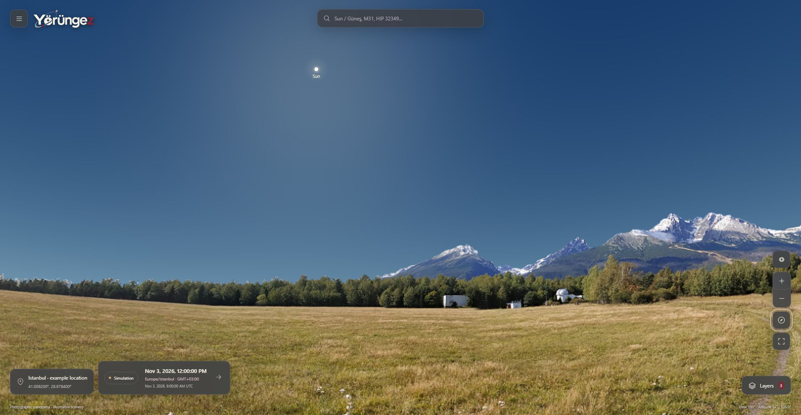
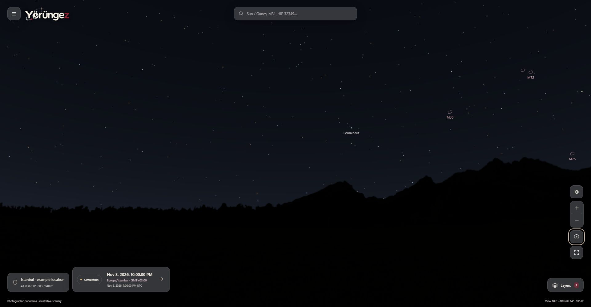
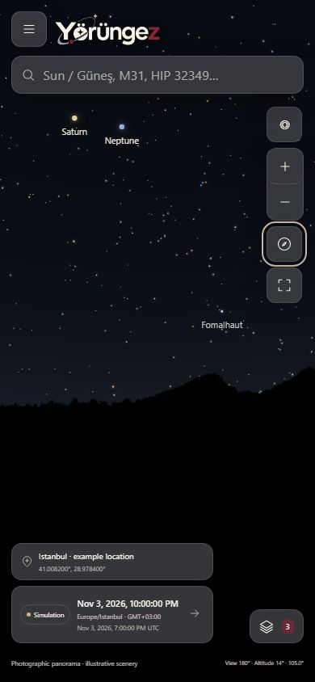

# yorungez

The [Flutter Android/iOS client](src/Yorungez.Mobile/README.md) now includes a full-screen phone-driven sky, one-second discovery, registered cosmic/constellation imagery, phased solar illustrations and calculated tracks, plus local SGP4 and a shared ISS data endpoint. [Current implementation evidence and physical/iOS/parity limits](docs/mobile-immersive-discovery-evidence.md) remain explicit.

Native **Tonight**, **Calendar** and server email reminders now share the sourced Web catalogue and account API. Local date/time, IANA zone and UTC stay explicit; event selections open a labelled sky simulation with a return-to-live action. [Implementation and verification](docs/mobile-night-calendar-reminders.md) · [English Google Play showcase](data/store/google-play/en-US/README.md).

Native accounts now share the API profile, language and server notebook; music/layer preferences, secure refresh, working source links and detail-to-sky focus are covered in the [account integration evidence](docs/mobile-account-integration.md).

<picture>
  <source media="(prefers-color-scheme: dark)" srcset="data/branding/exports/wordmark-on-dark.svg">
  
</picture>

**Explore the sky. Understand what you see. Keep your observations.**

[Live Web sky](https://yorungez.com/en) · [Astronomy library](https://yorungez.com/en/library) · [Project & science](https://yorungez.com/en/about) · [Android & iOS — coming soon](https://yorungez.com/en/mobile)

Free, ad-free and developed as a not-for-profit open-source project. Native apps are in development and are **not yet published in app stores**. The public Web library starts with eight sourced guides in English and Turkish; [discovery, measurement and release checks](docs/web-discovery-seo.md) document the implementation and its limits.

[](https://github.com/YeloraStudio/yorungez/actions/workflows/ci.yml)
[](https://github.com/YeloraStudio/yorungez/actions/workflows/codeql.yml)
[](LICENSE)

[English](README.md) · [Türkçe](README.tr.md) · [Documentation](docs/README.md) · [Contributing](CONTRIBUTING.md) · [Security](SECURITY.md)

Yorungez is an open-source, map-first astronomy application built around one question:

> **What is in the sky from here, where should I look, and when?**

The name combines the Turkish words *yörünge* (orbit) and *gezmek* (to explore). The experience starts with a full-screen sky, without requiring an account or equipment. English and Turkish are developed together; English is the default.

## Day and night

The same public Istanbul example, camera and default layers on **3 November 2026**. Only the simulation time changes: **12:00 / 09:00 UTC** and **22:00 / 19:00 UTC** (`Europe/Istanbul`, GMT+03:00). Open either image for full size.

| Day · 12:00 local | Night · 22:00 local |
|---|---|
| [](docs/ux/showcase/day.jpg) | [](docs/ux/showcase/night.jpg) |

<details>
<summary>Mobile / PWA layout · night</summary>



[Open the mobile screenshot](docs/ux/showcase/mobile-night.jpg). This is a responsive browser capture, not a physical-device performance or sensor test.

</details>

Actual application screenshots, with no personal account or device location. The landscape is **Ľubomír Hambálek's Stara Lesna Meadows**, an illustrative photographed environment in Slovakia, not the observer's local terrain. [Capture details and attribution](docs/ux/showcase/README.md). Celestial directions are calculated for the selected location/time; atmospheric brightness is an illustrative rendering.

## What you can do

| Experience | Current implementation |
|---|---|
| Explore the sky | Pan, zoom from 0.6° to 330°, search objects in either language, inspect transparent object cards and focus the map. |
| Choose your viewpoint | Permission-based device location, manual coordinates, local place search and optional OpenStreetMap point selection. |
| Understand time | Live/simulated time, UTC instants, IANA time zones, local offsets and explicit daylight-saving ambiguity handling. |
| Plan tonight | Sunset-to-sunrise visibility intervals and navigation to a selected target and instant; explicit polar conditions. |
| Browse events | A sourced calendar distinguishing calculated events from independently compared Moon-phase references. |
| Find a direction | True-bearing/altitude guidance and a sensor-free observing brief; optional device compass with permission/alignment safeguards. |
| Adjust the view | Atmosphere, native **4096×2048 panorama** on supported GPUs with bounded lower-resolution fallback, deep-sky objects, constellations, artwork, grids, night mode and full screen. Terrain becomes transparent below the horizon. |
| Inspect object imagery | 13 locally bundled archive-photo targets; licensed on-demand imagery or an explicitly labelled calculated finder view elsewhere. Source, credit and scientific context stay separate. |
| Explore our galaxy | Search Milky Way / Samanyolu for an attributed archival panorama and extended-sky context; explore the Sagittarius region without inventing one position for the whole galaxy. |
| Learn terminology | 52 paired English/Turkish terms with plain-language explanations, all sources, cross-language search and stable links on shared map/standalone glossary surfaces. |
| Keep a notebook | Verified accounts save notes, favourites, observations and locations in PostgreSQL. Personal records require a connection. |
| Reopen offline | A versioned, hash-checked PWA package provides the general catalogue, terms, calendar and calculation assets. |

The current catalogue contains **5,073 stars, 88 constellations, 107 Messier matches and 85 attributed constellation illustrations**. The event snapshot contains **2,623 records**. These are bounded datasets, not complete catalogues of everything observable.

Live mode computes directions locally for the current UTC time and observer; catalogue data and photographs are versioned or archival. The sources panel distinguishes calculation time, simulation and package preparation dates. Wikipedia/Commons use on-demand cached APIs; a continuously updated discovery/event alert feed is not connected yet. See the [runtime API inventory and refresh plan](docs/canli-hesap-ve-veri-guncelligi.md).

## Status and scientific boundaries

**Active development / experimental preview.** S23 Chrome/Brave and added-PWA general use received positive owner feedback; measured GPS, post-permission compass and the complete iPhone/Safari protocol remain open. Implemented software and recorded developer checks are distinct from full product acceptance. Physical GPS/compass validation, broader browser/device acceptance and production backup/restore acceptance remain open. There is no production-readiness or blanket scientific-accuracy certification.

Calculations use pinned Astronomy Engine 2.1.19 behind application adapters. Ordinary tests read frozen independent references and do not contact JPL or download fresh catalogues.

| Evidence | Recorded scope |
|---|---|
| Astropy comparisons | 144 star and 72 deep-sky position samples within the documented 1 arcminute tolerance. |
| JPL Horizons comparisons | 1,168 comparisons; two polar-azimuth exceptions remain documented. The API withholds azimuth at absolute latitude ≥89°. |
| USNO Moon phases | 1,781 reference instants; maximum recorded difference 79.946 s against a 120 s tolerance. |
| USNO rise/set | 22 reference samples; maximum recorded difference 25.48 s against a 180 s tolerance. |
| Application checks | **3 November 2026 baseline: 127 .NET tests, 65 client tests**, typecheck and production Web build; Linux production image/migration/readiness/BFF smoke checks passed in [PR #18 CI](https://github.com/YeloraStudio/yorungez/actions/runs/41627158885). |

The present calculation interval is **2000-01-01 through 2036-01-01 exclusive**. Geometric position, standard rise/set, weather conditions and actual detectability are separate concepts. Unknown weather or local obstructions remain unknown. A personal observation is a user's declaration, not independent scientific verification. Rendering brightness is not calibrated photometry.

See the [scientific strategy](docs/bilimsel-veri-stratejisi.md), [JPL method and polar exceptions](docs/astronomi-denemesi.md), [catalogue references](docs/harita-ve-katalog-denemesi.md) and [planning references](docs/gozlem-cizelgesi-ve-takvim.md).

## Architecture

A **modular monolith**, with Clean Architecture boundaries and CQRS handlers:

```text
Browser / PWA: Next.js + React + TypeScript
  sky worker · rendering · paired en/tr UI
          │ same-origin server routes (BFF)
          ▼
ASP.NET Core / .NET 10
  Identity · Astronomy · Catalog · Notebook
  Infrastructure → Application → Domain
          ├── PostgreSQL: accounts and private inventory
          ├── Redis: bounded server caching
          └── SMTP: verified-account transactional email

Pinned catalogues + frozen JPL / USNO / Astropy references
```

| Area | Technology |
|---|---|
| Backend | C# / .NET 10, ASP.NET Core, EF Core, JWT access tokens and refresh sessions |
| Application | CQRS, MediatR **12.5.0 (Apache-2.0)**, module-owned persistence |
| Frontend | Next.js 16.4.3, React 19.3.1, TypeScript 5.9.3, Canvas/WebGL and a sky worker |
| Verification | .NET/Node tests, Python reference tooling, source manifests and frozen independent evidence |

PostGIS is a possible future tool for terrestrial searches, light pollution and terrain analysis. It is not required for celestial coordinates or simple location storage. See [architecture decisions](docs/README.md#architecture-decisions).

## Run locally

Install Git, **PowerShell 7**, Docker with Compose, the .NET SDK selected by [global.json](global.json), **Node.js 22.20.0** and Python 3.12+ for repository checks. Lockfiles and image digests are committed.

```powershell
git clone https://github.com/YeloraStudio/yorungez.git
Set-Location yorungez
# Windows: keep this terminal open
./scripts/Start-LocalApp.ps1 -EmailMode Mailpit
```

On **Linux/macOS with PowerShell 7**, use two terminals from the repository root:

```powershell
# Terminal 1: infrastructure, migrations and API
./scripts/Start-LocalBackend.ps1 -EmailMode Mailpit
```

```powershell
# Terminal 2: frontend
./scripts/Start-Web.ps1
```

Open **http://127.0.0.1:5190/en** or **http://127.0.0.1:5190/tr**. The API uses loopback port 5187. Mailpit normally uses **http://127.0.0.1:8029**; if an infrastructure port is occupied, the initializer selects another value in the private `.env`.

The initializer creates random local credentials and private configuration without printing secrets, and preserves existing private files. Mailpit captures registration/recovery messages locally; follow the verification link there. No real SMTP account is required. Transactional emails use the brand palette and are in English in both UI languages.

The general map can run with `./scripts/Start-Web.ps1` alone; account features require the API/database. Start a production frontend/PWA build with `./scripts/Start-Web.ps1 -Production`. Offline support requires an initial successful online package installation; the normal development server is not an offline acceptance test. Linux CI verifies builds/tests; physical use on other operating systems remains a separate acceptance task.

Use Ctrl+C to stop foreground servers. On Windows, [Stop-LocalApp.ps1](scripts/Stop-LocalApp.ps1) handles only process identities recorded by the launcher. `docker compose stop` retains this project's volumes. Avoid simultaneous builds in the same Next.js output directory.

Details: [backend setup](docs/altyapi-ve-kimlik.md), [frontend setup](src/Yorungez.Web/README.md), [accounts/PWA](docs/hesap-menusu-ve-cevrimdisi-gokyuzu.md).

## Verify a change

From a PowerShell 7 terminal at the root:

```powershell
python scripts/verify_docs.py
./scripts/Verify-Backend.ps1
./scripts/Verify-Web.ps1
./scripts/Verify-Science.ps1 -Offline
```

The backend suite includes a [local synthetic PostgreSQL/key-ring recovery drill](docs/yerel-yedek-geri-yukleme.md). Run it alone with `./scripts/Verify-Recovery.ps1 -Offline` while this project's PostgreSQL is already running. It creates and removes its own test databases; production recovery acceptance remains pending.

The first backend/Web checks install locked dependencies. Offline science assumes installed dependencies. Integration tests create and remove their own randomly named local test databases and replace email delivery with test capture. Reference refreshes are explicitly requested operations; see [reference tooling](tests/ReferenceData/README.md).

Before committing, stage the reviewed public files and run:

```powershell
python scripts/check_publication.py
```

This checks indexed blobs for private paths/common secret forms and locally compares private environment values without displaying them. CI also runs Gitleaks against Git history. These checks complement review; they cannot guarantee detection of every possible secret or defect.

## Deploy on your own server

The **Ubuntu + Docker Standalone + Portainer + Traefik** package is ready for operator-run installation. The domain has been acquired; this repository does not establish that the application is already live.

| Configured deployment origin | Service |
|---|---|
| `https://yorungez.com` | Next.js Web / PWA / same-origin BFF |
| `https://api.yorungez.com` | ASP.NET Core API / future mobile clients |

Use the [deployment runbook](deploy/README.md), [production stack](deploy/compose.yml) and [placeholder environment template](deploy/.env.example). Separate non-root images, one-shot migrations, isolated database networking, durable PostgreSQL/Redis/keyring storage and explicitly trusted proxy hops are included. The host initializer prepares an encrypted PFX and a placeholder-only private template; operators supply real secrets locally.

Build both images on the selected Docker host, enter the actual Traefik network/IP/entrypoint/resolver and private configuration, then deploy through Portainer. Public DNS/TLS, real SMTP delivery and production acceptance are operator tasks. CI builds and smoke-tests disposable containers; it does not connect to your server or publish images automatically.

## Privacy and deployment

- Basic exploration is anonymous. Personal saves require a verified account and are scoped to its owner in PostgreSQL.
- Personal notebooks have no browser-persisted/offline write queue. PWA caches contain public general assets; account/API responses and personal coordinates are excluded.
- Location permission is optional. Manual input works without it; external map tiles load only after the relevant user action.
- `.env`, local settings, key rings, database dumps, production overrides and Portainer configuration stay outside Git. Only placeholder templates and generic development/production recipes are published; actual server settings remain private.
- Keep production secrets in a private server environment or secret store. Root `compose.yaml` is the local development setup; `deploy/compose.yml` is the separate operator-run production recipe. CI has no live deployment access.

See [SECURITY.md](SECURITY.md) and the [publication review](docs/open-source-publication.md). Report vulnerabilities privately through the repository's Security tab.

## Roadmap

The [requirements](docs/urun-gereksinimleri.md), [roadmap](docs/yol-haritasi.md) and [traceability](docs/teslimat-izlenebilirligi.md) remain the source of scope. Publication does not complete remaining acceptance work:

- Sourced atlas photographs, concise information, catalogue coverage and independently validated event types; the current information/visual priority remains in place.
- Physical GPS/compass permission, direction, calibration and stale-data acceptance.
- Cross-browser/device PWA installation, update and storage-eviction acceptance.
- Production acceptance remains open; the deployment package is prepared and the owner will perform the actual server rollout. A synthetic local restore drill passed, and new backup/trash work is currently deferred.
- Additional calendar event types with explicit sources and independent validation.
- Later catalogue, equipment and terrestrial observing-site capabilities, guided by existing priorities.

The [2 November plan audit and checklist](docs/web-tamamlama-ve-ortak-backend-mobil-hedef.md) records implemented, partial and deferred work. The next platform goal is a mobile application using the same .NET backend, accounts and data **after Web acceptance**; no native framework has been selected.

## Contribute

Bug reports, reproducible scientific comparisons, accessibility improvements and paired English/Turkish contributions are welcome. Read [CONTRIBUTING.md](CONTRIBUTING.md). Keep evidence, assumptions, source licences and limitations together. Never attach real accounts, private locations or credentials to public issues.

Most detailed product records are currently Turkish. The [documentation index](docs/README.md) provides English navigation; the [historical status log](docs/project-status-history.md) preserves earlier package records.

## Licence and attribution

Original Yorungez code and original project documentation use **[Apache-2.0](LICENSE)**. See [NOTICE](NOTICE).

**Third-party code, scientific data, photographs and artwork retain their own licences.** These include CC BY-SA catalogue data, Free Art License illustrations, Commons imagery and GeoNames data. The landscape source has differing upstream licence statements; both are preserved. Redis is a separate service with its own licence choice. Apache-2.0 does not relicense these materials.

Read [THIRD_PARTY_NOTICES.md](THIRD_PARTY_NOTICES.md), [source notices](third-party/), [catalogue provenance](data/catalog/README.md) and [landscape attribution](third-party/stara-lesna/NOTICE.md) before redistributing a bundle or derived dataset.

Built by [YeloraStudio](https://github.com/YeloraStudio) and contributors, following the evidence wherever it leads.
