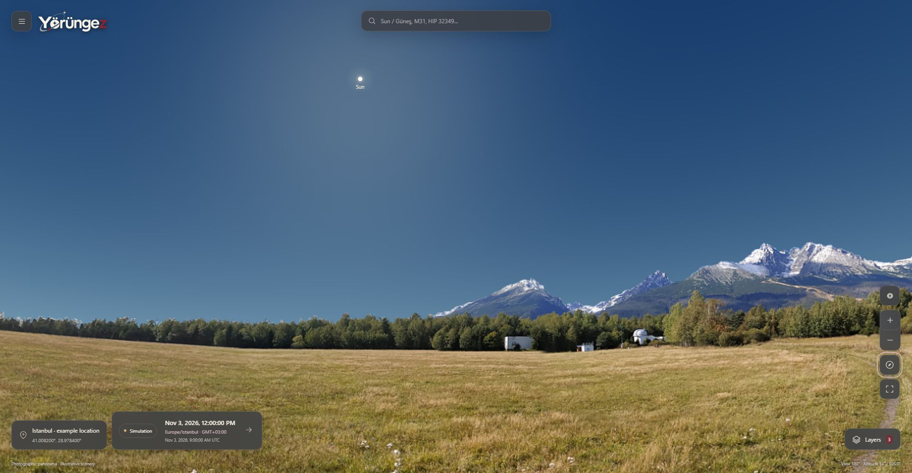
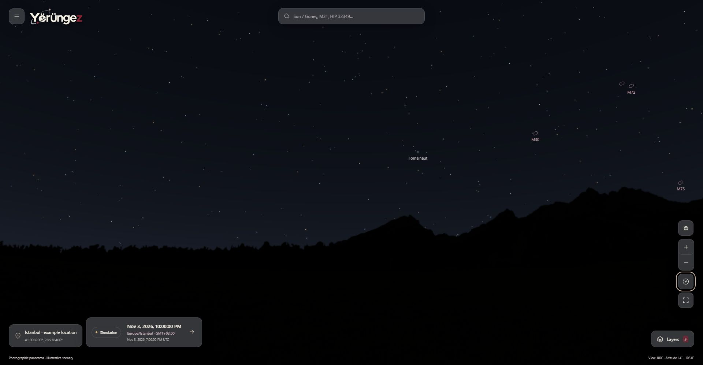
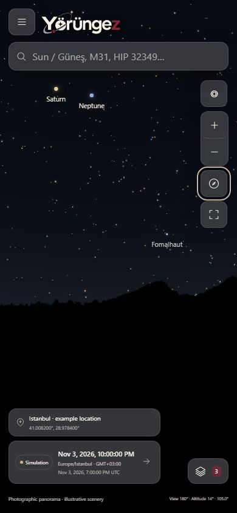

# yorungez

[Flutter Android/iOS istemcisi](src/Yorungez.Mobile/README.md) tam ekran telefonla takip, bir saniyelik keşif, koordinatlara bağlı kozmik gökyüzü/takımyıldız görselleri, evreli gezegen çizimi ve hesaplanan izleri içerir; yerel SGP4 ve ortak ISS veri endpoint’i de hazırdır. [Güncel uygulama kanıtları ve açık fiziksel/iOS/özellik eşliği işleri](docs/mobile-immersive-discovery-evidence.md) ayrı izlenir.

Mobil hesaplar aynı API profilini, dilini ve sunucu defterini kullanır; müzik/katman tercihleri, güvenli oturum yenileme, çalışan kaynak bağlantıları ve detaydan gökyüzüne odaklama için [uygulama kanıtları](docs/mobile-account-integration.md) kayıtlıdır.

<picture>
  <source media="(prefers-color-scheme: dark)" srcset="data/branding/exports/wordmark-on-dark.svg">
  
</picture>

**Gökyüzünü keşfet. Gördüğünü anla. Gözlemlerini sakla.**

[English](README.md) · [Dokümantasyon](docs/README.md) · [Katkı rehberi](CONTRIBUTING.md) · [Güvenlik](SECURITY.md)

Yorungez, **“Buradan gökyüzünde ne var, nereye bakmalıyım, ne zaman görebilirim?”** sorusuna odaklanan açık kaynak astronomi uygulamasıdır. Adı *yörünge + gezmek* birleşiminden gelir. Tam ekran haritayı keşfetmek için hesap veya ekipman gerekmez. İngilizce ve Türkçe birlikte geliştirilir; varsayılan dil İngilizcedir.

## Gündüz ve gece

**3 Kasım 2026**, aynı genel İstanbul örneği, aynı kamera ve varsayılan katmanlar. Yalnız simülasyon saati değişir: **12:00 / 09:00 UTC** ve **22:00 / 19:00 UTC** (`Europe/Istanbul`, GMT+03:00). Tam boyut için görsele tıklayın.

| Gündüz · yerel 12:00 | Gece · yerel 22:00 |
|---|---|
| [](docs/ux/showcase/day.jpg) | [](docs/ux/showcase/night.jpg) |

<details>
<summary>Mobil / PWA yerleşimi · gece</summary>



[Mobil ekran görüntüsünü aç](docs/ux/showcase/mobile-night.jpg). Bu bir responsive tarayıcı çekimidir; fiziksel cihaz performans/sensör testi değildir.

</details>

Görseller doğrudan çalışan uygulamadan alındı; kişisel hesap veya cihaz konumu içermez. Fotoğraf çevre **Ľubomír Hambálek / Stara Lesna Meadows** kaynaklıdır; Slovakya'da çekilmiş temsili arazidir, kullanıcının gerçek çevresi değildir. [Çekim ve atıf bilgileri](docs/ux/showcase/README.md). Göksel yönler seçili konum/zaman için hesaplanır; atmosfer parlaklığı temsili çizimdir.

Samanyolu / Milky Way araması kaynaklı panorama ve galaksimizin içinden bakış açıklamasını açar; Yay bölgesine geçiş vardır, tüm galaksiye tek konum atanmaz. [Mobil kart ve sensör izinleri](docs/mobil-kart-samanyolu-ve-pusula-erisim.md).

Canlı mod, güncel UTC anı ve gözlem konumuna göre yönleri yerelde hesaplar; kataloglar sürümlü, fotoğraflar arşivdir. Kaynak paneli hesap anı/simülasyon/paket tarihlerini ayırır. Wikipedia/Commons isteğe bağlı önbellekli API kullanır; sürekli yeni olay/uyarı akışı henüz bağlı değildir. [Çalışan API envanteri ve yenileme planı](docs/canli-hesap-ve-veri-guncelligi.md).

## Mevcut deneyim

- Sürüklenebilir gökyüzü; 0,6°–330° yakınlaştırma, iki dilde arama, saydam nesne kartı ve hedefe odaklanma.
- İzinli cihaz konumu, manuel koordinat, yerel yer araması ve isteğe bağlı OpenStreetMap seçimi.
- Canlı/simülasyon zamanı, tek UTC anı, IANA saat dilimleri ve yaz saati belirsizliğinin açık yönetimi.
- **Bu gece:** gün batımı–doğumu arasında hedef çizelgesi ve seçilen saate/hedefe geçiş.
- Kaynaklı takvim; hesaplanan olaylar ve bağımsız referansla karşılaştırılan Ay evreleri ayrı gösterilir.
- Sensörsüz yön/yükseklik ve dürbün rehberi; uygun cihazlarda izin/hizalama gerektiren pusula.
- Atmosfer, uygun GPU’da özgün **4096×2048 fotoğraf panorama** ve sınırlı cihazlarda küçük dokuya dönüş, derin uzay, takımyıldız çizgileri/çizimleri, ızgaralar, gece ve tam ekran katmanları. Ufuk altındaki hedeflerde arazi saydamlaşır.
- 13 hedefte kaynaklı yerel arşiv fotoğrafı; diğer nesnelerde lisanslı isteğe bağlı fotoğraf veya açıkça etiketli hesaplanan konum kesiti.
- 52 sade açıklamalı Türkçe/İngilizce terim; ortak harita/sözlük sayfasında iki dilden arama, tüm kaynaklar ve sabit terim bağlantıları.
- Doğrulanmış hesaba bağlı PostgreSQL defteri: not, favori, gözlem ve kayıtlı konum. Kişisel kayıtlar bağlantı gerektirir.
- Genel katalog/terim/takvim ve hesaplama varlıklarını sürümlü, hash kontrollü paketle yeniden açabilen PWA.

İlk veri dilimi **5.073 yıldız, 88 takımyıldız, 107 Messier eşleşmesi, 85 kaynaklı çizim ve 2.623 takvim kaydı** içerir. Bunlar tüm gökyüzü nesnelerini kapsayan eksiksiz kataloglar değildir.

## Durum ve bilimsel sınırlar

**Aktif geliştirme / deneysel önizleme.** S23 Chrome/Brave ve PWA genel kullanımında olumlu kullanıcı bildirimi var; bu, ölçümlü GPS/pusula veya iPhone/Safari protokolünün tamamlandığı anlamına gelmez. Fiziksel GPS/pusula, geniş tarayıcı/cihaz ve üretim yedekleme/geri yükleme kabulü açıktır. Uygulanan yazılım, tam ürün kabulü veya bilimsel doğruluk sertifikası anlamına gelmez.

Hesap adaptörü Astronomy Engine 2.1.19 kullanır. Donmuş bağımsız referanslarda 144 yıldız ve 72 derin uzay örneği 1 yay dakikası toleransıyla karşılaştırılmıştır. 1.168 JPL karşılaştırmasındaki iki kutup azimut istisnası korunur; API mutlak enlem ≥89° için azimut vermez. 1.781 USNO Ay evresinde kaydedilen en büyük fark 79,946 saniye; 22 doğuş/batış örneğinde 25,48 saniyedir. Yöntem ve toleranslar [bilimsel belgelerde](docs/bilimsel-veri-stratejisi.md) açıklanır.

Mevcut hesap aralığı **2000-01-01 dahil, 2036-01-01 hariç** sınırındadır. Geometrik konum, standart doğuş/batış, hava ve gerçekten seçilebilirlik ayrıdır. Bilinmeyen hava/arazi bilgisi uydurulmaz. Kişisel gözlem kullanıcı beyanıdır. Görsel parlaklık kalibre fotometri değildir.

**3 Kasım 2026 doğrulanmış temel: 127 .NET ve 65 istemci testi**, tip kontrolü/üretim Web derlemesi ve Linux üretim container build/migration/readiness/BFF smoke testleri. [PR #18 CI kanıtı](https://github.com/YeloraStudio/yorungez/actions/runs/41627158885). Güncel sonuçlar [GitHub Actions](https://github.com/YeloraStudio/yorungez/actions) üzerinden izlenir.

## Teknik temel

C# / **.NET 10**, Clean Architecture, CQRS ve **MediatR 12.5.0 (Apache-2.0)** kullanan modüler monolit. Kimlik, astronomi, katalog ve defter modülleri kendi sınırlarını korur. Next.js + React + TypeScript arayüzü aynı kökenli sunucu rotalarıyla API'ye ulaşır. Kişisel veriler PostgreSQL'de, uygun sunucu önbellekleri Redis'tedir.

PostGIS göksel hesap için gerekmez; ileride Dünya üzerindeki gözlem alanı, ışık kirliliği ve arazi analizleriyle gerekçelendirilirse değerlendirilir. [Mimari kararlar](docs/README.md#architecture-decisions).

## Yerelde çalıştırma

Git, **PowerShell 7**, Docker/Compose, [global.json](global.json) içindeki .NET SDK, **Node.js 22.20.0** ve belge kontrolleri için Python 3.12+ gerekir.

```powershell
git clone https://github.com/YeloraStudio/yorungez.git
Set-Location yorungez
# Windows: terminal açık kalmalı
./scripts/Start-LocalApp.ps1 -EmailMode Mailpit
```

Linux/macOS'ta PowerShell 7 ile kökten iki ayrı terminalde `./scripts/Start-LocalBackend.ps1 -EmailMode Mailpit` ve `./scripts/Start-Web.ps1` çalıştırılır. Linux CI derleme/test doğrular; diğer işletim sistemlerindeki fiziksel kullanım kabulü ayrıdır.

**http://127.0.0.1:5190/en** veya **http://127.0.0.1:5190/tr** adresini aç. API 5187 portundadır. Mailpit varsayılan olarak **http://127.0.0.1:8029** üzerinde doğrulama/sıfırlama mesajlarını tutar; gerçek SMTP hesabı gerekmez. Başlatıcı dolu altyapı portları için özel `.env` içinde başka değer seçebilir. Rastgele sırlar üretilir, mevcut özel dosyalar korunur, sırlar yazdırılmaz.

Yalnız genel harita `./scripts/Start-Web.ps1` ile açılır. Hesap işlemleri API/veritabanı ister. Üretim Web/PWA derlemesi için `./scripts/Start-Web.ps1 -Production`; çevrimdışı açılış için ilk başarılı çevrimiçi paket kurulumu gerekir.

Sunucular Ctrl+C ile kapatılır. Windows'ta [Stop-LocalApp.ps1](scripts/Stop-LocalApp.ps1) yalnız başlatıcının kaydettiği süreçleri yönetir. `docker compose stop` bu projenin altyapısını durdurur, verileri korur. Aynı Next.js çıktı klasörüne eşzamanlı derleme yapma. [Ayrıntılı kurulum](README.md#run-locally).

## Doğrulama

```powershell
python scripts/verify_docs.py
./scripts/Verify-Backend.ps1
./scripts/Verify-Web.ps1
./scripts/Verify-Science.ps1 -Offline
# İncelenen public dosyalar stage edildikten sonra:
python scripts/check_publication.py
```

Backend testleri [yerel sentetik PostgreSQL/anahtarlık kurtarma provasını](docs/yerel-yedek-geri-yukleme.md) da kapsar. Projenin PostgreSQL servisi açıkken yalnız bu prova için `./scripts/Verify-Recovery.ps1 -Offline` çalıştırılabilir. Kendi test veritabanlarını oluşturup kaldırır; üretim kurtarma kabulü bekler.

Offline bilimsel kontrol bağımlılıkların kurulu olmasını bekler. Normal testler donmuş referansları okur; dış bilimsel veri indirmez. Entegrasyon testleri kendi yerel test veritabanlarını oluşturup temizler, e-posta yakalama kullanır. Yayın kontrolü Git index'ini tarar; özel `.env` değerlerini göstermeden karşılaştırır. CI ayrıca Gitleaks taraması yapar. Bunlar bütün sızıntıları veya hataları bulma garantisi vermez.

## Kendi sunucunuzda deployment

**Ubuntu + Docker Standalone + Portainer + Traefik** paketi hazırdır. Alan adı satın alındı; uygulamanın canlı yayına alınması sunucu yöneticisinin yapacağı ayrı adımdır.

| Yapılandırılmış yayın adresi | Servis |
|---|---|
| `https://yorungez.com` | Next.js Web / PWA / aynı kökenli BFF |
| `https://api.yorungez.com` | ASP.NET Core API / ileride mobil istemciler |

[Kurulum rehberi](deploy/README.md), [üretim stack’i](deploy/compose.production.yaml) ve [örnek ortam şablonu](deploy/.env.example) birlikte kullanılır. Root olmayan ayrı image’lar, tek seferlik migration, izole veritabanı ağı, kalıcı PostgreSQL/Redis/keyring ve belirli güvenilen proxy adresleri hazırdır. Sunucu hazırlık aracı şifreli PFX ve yalnız placeholder içeren özel şablon üretir; gerçek sırları operatör yerelde girer.

Image’ları ilgili Docker host’unda build edin, gerçek Traefik network/IP/entrypoint/resolver ve özel ortam değerlerini doldurun, ardından Portainer’dan deploy edin. Public DNS/TLS, gerçek e-posta teslimi ve üretim kabulü sizde kalır. CI kendi geçici container’larını sınar; sunucunuza bağlanmaz ve otomatik yayın yapmaz.

## Gizlilik, yol haritası ve katkı

Kişisel kayıtlar doğrulanmış hesapla sunucuda kalır; anonim kalıcı defter veya çevrimdışı kişisel yazma kuyruğu yoktur. PWA yalnız genel varlıkları saklar; kişisel API yanıtları ve koordinatlar bu pakete alınmaz. Konum izni isteğe bağlıdır.

`.env`, yerel ayarlar, anahtar halkaları, veri dökümleri, üretim override'ları ve Portainer ayarları Git dışında kalır. Yalnız placeholder örnekler ve genel geliştirme/üretim tarifleri yayımlanır; gerçek sunucu yapılandırması özel kalır. Üretim sırları sunucunun özel ortamında/secret store'da yönetilmelidir. Kökteki `compose.yaml` geliştirme içindir; üretim için ayrı `deploy/compose.production.yaml` ve kurulum rehberi vardır.

[Güvenlik](SECURITY.md), [yayın incelemesi](docs/open-source-publication.md), [katkı rehberi](CONTRIBUTING.md), [gereksinimler](docs/urun-gereksinimleri.md), [yol haritası](docs/yol-haritasi.md) ve [izlenebilirlik](docs/teslimat-izlenebilirligi.md) kapsamı açıklar. Yayınlama önceki planı değiştirmez veya eksik kabul işlerini kapatmaz.

Güncel öncelik kaynaklı nesne görselleri/kısa bilgiler ve atlas derinliğidir. Fiziksel GPS/pusula, çok tarayıcı PWA, bilimsel olay/koşul ve üretim kabulü açık; yeni yedek/çöp işleri ertelenmiştir. Deployment paketi hazırdır; gerçek sunucu yayını operatör tarafından yapılacaktır. [2 Kasım plan denetimi ve checklist](docs/web-tamamlama-ve-ortak-backend-mobil-hedef.md) bütün kalanları içerir. Kullanıcının sonraki platform hedefi, Web kabulünden sonra aynı .NET backend/hesap/verilerle mobil uygulamadır; framework seçilmedi, P1/P2 kapsamı korunur.

## Lisans

Özgün Yorungez kodu ve özgün proje belgeleri **[Apache-2.0](LICENSE)** lisanslıdır; [NOTICE](NOTICE) geçerlidir. **Üçüncü taraf kod, katalog, fotoğraf, çizim ve veriler kendi lisanslarında kalır.** CC BY-SA, Free Art License ve diğer kaynak şartları Apache-2.0 ile yeniden lisanslanmış değildir. Arazi kaynağındaki farklı lisans bildirimleri birlikte korunmuştur.

Yeniden dağıtım öncesi [THIRD_PARTY_NOTICES.md](THIRD_PARTY_NOTICES.md), [kaynak lisansları](third-party/) ve [katalog kökenini](data/catalog/README.md) incele.

[YeloraStudio](https://github.com/YeloraStudio) ve katkıda bulunanlar tarafından geliştirilir.
