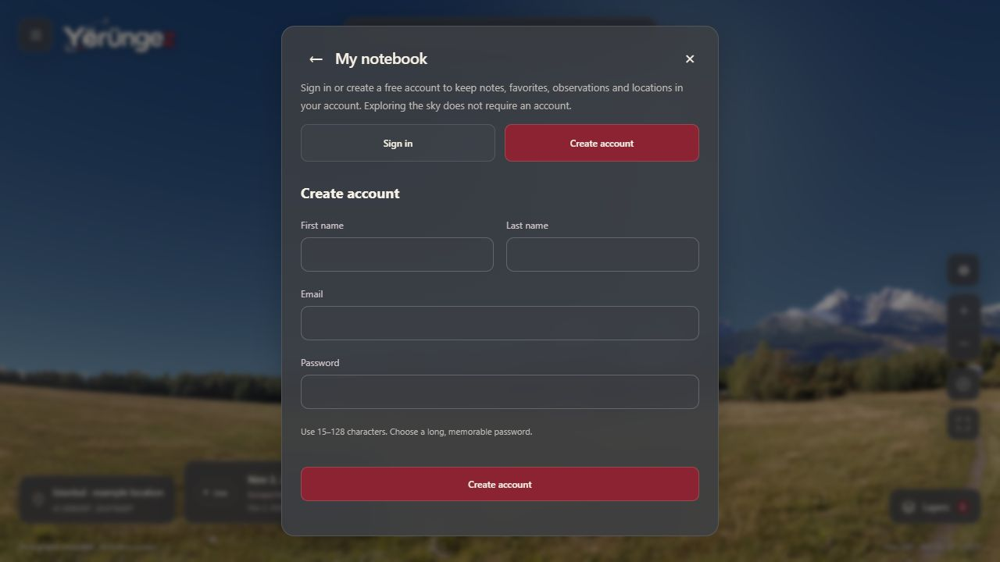
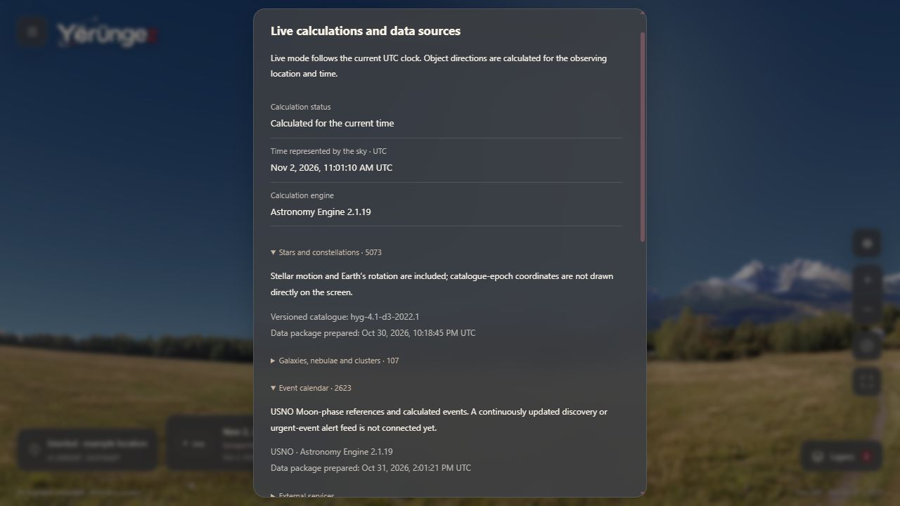

# TECH-11B / K-035 — Hesap formları ve canlı bilimsel veri durumu

**2 Kasım 2026.** Kullanıcı giriş/kayıt başlıklarının boşluk ve hizasını düzeltti; canlı, kaynaklı ve bilimsel gökyüzü hedefini yeniden teyit etti. İz: **FR-02–05/FR-08–09/FR-11, UJ-01–03/UJ-06–07, AC-02–04/AC-10/AC-12–13**. Bu paket veri durumunu görünür kılar; geniş atlas veya sürekli keşif/uyarı akışını tamamlanmış saymaz. [Önceki plan](yayin-oncesi-yerel-plan.md) ve K-032 dağıtım beklemesi korunur.

## Form düzeltmesi

Giriş/kayıt seçimleri aynı genişlikte, en az 48 px yüksekliğinde ve ortalanmıştır. Seçimlerle form başlığı arasında 28 px, başlıkla form arasında 20 px bulunur. Alanlar arasında 20 px, masaüstü ad/soyad sütunları arasında 16 px vardır. Gönderme düğmesi form genişliğini kullanır. Dar ekranda ad/soyad alt alta gelir; uzun form dikey kaydırılır. Görünüm değişince başlık odağı gerektiğinde görünür alana kayar; ilk dialog başlığı odağı korunur.

[İngilizce giriş](ux/live-data/sign-in-desktop-en.jpg), [320 px İngilizce giriş](ux/live-data/sign-in-320-en.jpg), [320 px Türkçe kayıt](ux/live-data/register-320-tr.jpg). Tarayıcı denetiminde iki dilde yatay taşma yoktur. Form gönderilmedi; gerçek e-posta/parola/konum kullanılmadı. Bu, tam erişilebilirlik veya gerçek telefon kabulü değildir.

## Şu anda ne canlı?

| Veri | Çalışan mekanizma | Güncellik ve kapsam sınırı |
|---|---|---|
| Güneş, Ay ve yedi gezegen | Astronomy Engine 2.1.19; canlı mod cihazın UTC saatini yaklaşık her saniye Worker hesabına verir | Seçili konum/an için hesap; her karede NASA API çağrısı yok. Cihaz saati yanlışsa sonuç yanlış anı temsil eder; harici saat eşitlemesi uygulanmadı. |
| Yıldızlar / takımyıldızlar | Sürümlü HYG 4.1/d3 kataloğu; hareket, paralaks, yaklaşık yıllık aberasyon ve seçili zamana koordinat dönüşümü | 5073 yıldız/88 takımyıldız; tüm yıldız evreni değildir. Katalog hazırlanma tarihi yeni bilimsel gözlem tarihi değildir. |
| Galaksiler / bulutsular / kümeler | OpenNGC kaynaklı 107 Messier eşleşmesinin J2000 koordinatları seçili anın yerel gökyüzüne dönüştürülür | Tam NGC/derin uzay kataloğu ve değişken kaynak akışı yok; görüntüler arşivdir. |
| Takvim | 2623 kayıtlı olay; USNO Ay evresi referansları ve hesaplanan Güneş Sistemi olayları | 1781 USNO evresi bağımsız karşılaştırıldı; her olay türü aynı doğrulama düzeyinde değildir. Sürekli keşif, süpernova veya acil olay bildirimi akışı bağlı değil. |
| Bilgi kartları | Wikipedia/Commons API'leri isteğe bağlı, revizyon/kaynak/lisans ve önbellekle | İçerik 24 saatlik süreç önbelleği/1 saatlik HTTP önbelleği kullanabilir. Güneş açıklama/görseli kaynaklı yerel arşivdir. API içeriği efemeris hesabının kaynağı değildir. |
| Dünya haritası / yer arama | Harita açılınca OSM döşemeleri; GeoNames yer kataloğu ve yerel saat dilimi poligonları | Google Maps koordinat iyileştirmesi yok. Harita seçimi GPS doğruluğunu artırmaz. Konum sorguları kişisel cache'e girmez. |
| Bağımsız efemeris referansı | JPL Horizons'tan açık yenileme işlemiyle alınan donmuş test verisi | Normal test/build çevrimiçi referans indirmez. Runtime harita JPL API erişimine bağımlı değildir. |
| Gözlem koşulları | Bilinmiyor; fotoğraf panorama ve atmosfer çizimi temsili | Canlı hava, bulut, ışık kirliliği ve ölçülmüş yerel ufuk verisi henüz yok. Geometrik konum, algılanabilirlik veya canlı teleskop görüntüsü değildir. |

Canlı astronomik harita için temel gereksinim doğru zaman/konumla hesap ve doğrulanmış kaynaklardır; HTTP çağrısının sürekli tekrarı kendi başına doğruluk kanıtı değildir. Motorun [resmî kaynakları](https://github.com/cosinekitty/astronomy) ve JPL'nin [Horizons açıklaması](https://ssd.jpl.nasa.gov/horizons/manual.html) farklı hesap/referans rollerinin dayanağıdır. Ürünün gerçek uygulama sınırları yukarıdaki envanter ve depo koduyla belirlenir.

## Uygulanan durum paneli

**Menü → Veri ve görsel atıfları / Data and image attribution** içinde iki dilde:

- Hesap bekleniyor, hata, yeni bağlam hesaplanıyor, güncel zaman hesabı, simülasyon ve eski hesap durumu ayrılır.
- Gösterilen sonuç karesinin UTC anı ve motor sürümü vardır. Bu an, hesabın sunucuda tamamlandığı zaman diye etiketlenmez.
- Yıldız/DSO/olay sayıları, sürüm ve kaynak manifestindeki paket hazırlanma tarihleri açılır ayrıntıdadır. Build zamanı yeni bir veri yenilemesi gibi yazılmaz; tarih yoksa kaydedilmemiş gösterilir.
- Olay akışının henüz bağlı olmadığı, arşiv görüntüleri ve bilinmeyen koşullar açıkça anlatılır. Mevcut lisans/atıflar korunur.

Canlı modda sonuç anı cihaz saatinden 10 saniyeden fazla uzaksa eski etiketlenir. Bu eşik **arayüz güncellik tanısıdır**; astronomik hata toleransı veya görünürlük garantisi değildir. Konum/yükseklik değişip eski kare ekranda kaldığında yeni bağlam beklenir; simülasyonda eski tarih tek başına gecikme sayılmaz. Worker'ın süre/ready/son istek korumaları değişmez.

`stage-assets.mjs`, hash doğrulanmış mevcut manifestlerden küçük `generated/data-status.json` üretir. Dosya kaynak kontrolüne alınmaz; derlenmiş genel istemci varlığı içinde PWA paketine girer. Ek ağ bağımlılığı, yeni veri indirimi veya kişisel cache eklenmez. Hassas koordinat veya hesap bilgisi bu metadatada bulunmaz.

[Türkçe 320 px panel](ux/live-data/sources-320-tr.jpg). Simülasyonda 9 Kasım 2026 07:02 UTC Ay olayı seçildiğinde panel aynı UTC anını ve simülasyon etiketini gösterdi; şimdiye dönüşte canlı etiketine döndü.

## Doğrulama

- **53 istemci testi**, TypeScript ve ayrı `.next-preview` üretim derlemesi geçti. Yeni testler canlı/simülasyon/eski/hatalı/konumu uyuşmayan sonuçları ve kaynak tarihinin build tarihiyle değiştirilmemesini kapsar.
- IAB üretim arayüzünde İngilizce/Türkçe form, 320 px taşma, başlık boşlukları ve simülasyon/canlı durum geçişi kontrol edildi.
- Çekirdek PWA paketi hazır olduktan sonra yalnız ajanın önizleme sunucusu durduruldu: aynı kökende Türkçe sayfa yeniden açıldı, yerel gökyüzü hesabı ve yeni kaynak metadatası çalıştı. API/işletim sistemi ağı kapatılmadı; bu kontrol harici servislerin çevrimdışı kullanılabildiği veya fiziksel PWA kurulum kabulü anlamına gelmez. Önizleme geri başlatıldı; kullanıcının normal uygulaması etkilenmedi.
- [Makine okunur UI sonucu](science/live-data-qa.json). Hesap algoritması, motor sürümü veya referans toleransları değişmedi. Mevcut 2000–2035 model aralığı, abs(enlem) ≥89° azimut kısıtı ve iki korunmuş kutup başarısızlığı sürer; bu paket yeni astrometrik doğruluk iddiası üretmez.

## FR-08 / P1 devam sözleşmesi

Kullanıcının canlı ve bilimsel tüm nesne/önemli olay hedefi mevcut kapsam içinde korunur. Aşağıdakiler **sıradaki veri teslimatlarının kabul işleri**, bu pakette uygulanmış sürekli servisler değildir:

1. Kaynak envanteri: nesne/olay kimliği, birim, koordinat çerçevesi/çağı, UTC/zaman ölçeği, geçerlilik aralığı, lisans, revizyon ve kaynak bağlantısı.
2. Kontrollü içeri alma: veri biçimi/kimlik/birim doğrulaması, kaynak türüne uygun bağımsız referans karşılaştırması, hatalı sürümün reddi ve önceki doğrulanmış paketin korunması.
3. Kaynak türüne göre yenileme sıklığı ve son başarılı alım zamanı; güncel/gecikmiş/erişilemiyor durumu, süre sınırı, geri çekilme ve önbellek. Paket hazırlanma zamanı ile sağlayıcıdan başarılı alım aynı alan değildir.
4. Daha geniş yıldız/NGC/galaksi/bulutsu atlası; meteor, tutulma, asteroit ve Ay–yıldız olayları; önemli yeni/geçici olay akışı için güvenilir sağlayıcı, lisans ve tür bazında doğrulama. Haber/fotoğraf servisi tek başına efemeris veya doğrulanmış olay akışı sayılmaz.
5. Her yenilemede iki dil, terimler, kaynak/güncellik/hata gösterimi, PWA genel paket sürümü ve performans bütçesi birlikte kontrol edilir. Saf pan/zoom veya saniyelik hesap dış servis çağrılarına bağlanmaz.

Önce mevcut P0 iki dil/erişilebilirlik kapsamında sözlük/derin bağlantı ve diğer açık kabul işleri, ardından kayıt yaşam döngüsü ve performans ölçümü devam eder. P1 geniş veri/yenileme ve P2 ekipman kapsamı atlanmaz. Deployment, HTTPS ve buna bağlı fiziksel kabul K-032 ile beklemededir.
