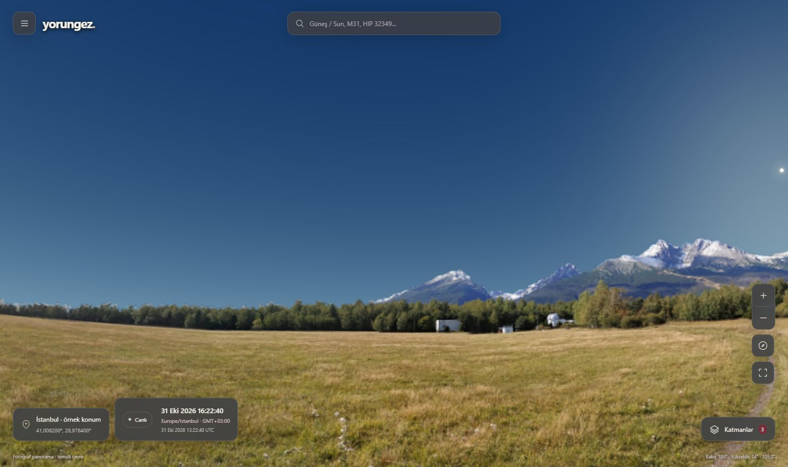
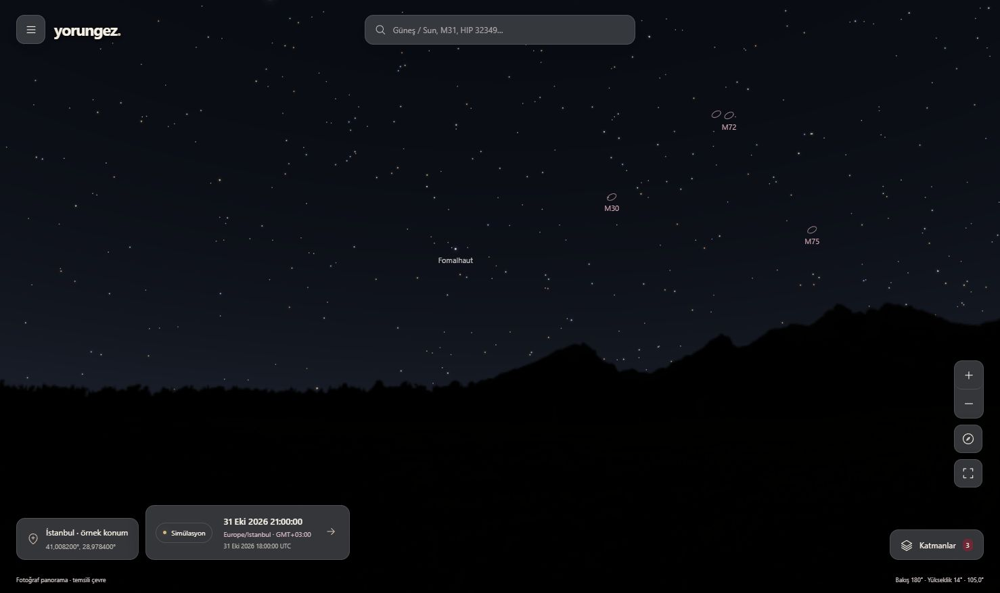

# TECH-04B — Doğal gökyüzü, marka paleti ve pusula aracı

**Sonraki güncel paket:** [TECH-04C çizelge/takvim/yer adı/saydam geniş açı](gozlem-cizelgesi-ve-takvim.md). Aşağıdaki sayılar ve ekranlar bu belgenin kendi aşamasının tarihsel kanıtıdır; yeni kapsam ve kalanlar güncel kayıtta tutulur.

**31 Ekim 2026.** Kullanıcının renk/görünüm düzeltmesi ve mevcut sonraki konum/pusula basamağı. İz: FR-01–03/08–09/11–12; UJ-01–03/06; AC-01–04/09–14; K-020. [Önceki tam ekran paketi](tam-ekran-harita-gelistirmesi.md), [bütün kalan işler](teslimat-izlenebilirligi.md). MVP-0/P0/P1/P2 kapsamı korunur.

## Uygulanan görünüm

Beğenilen tam ekran yerleşim, kapalı sol menü, yüzen saydam kartlar ve üç varsayılan katman korunur. Kullanıcının beş kaynak rengi CSS değişkenleri olarak sabittir: **#3C3F43**, **#9EA1A6**, **#8B2333**, **#C9B6A6**, **#F7F1E6**. Saydamlık/etkileşim durumları bu paletten türetilir. Palet UI'ye aittir; gökyüzünün fiziksel rengini bordo/griye zorlamaz. Dil seçimi sol menüde etiketli native açılır listedir: Türkçe/English. Konum, UTC anı, simülasyon modu, kamera, seçili nesne ve katmanlar dil değişiminde korunur.

Düz renk çim/çizgi dokusunun yerine **Stara Lesna Meadows** gerçek fotoğraf panoraması eklendi. Küresel fotoğraf bakış yönüne ve aynı stereografik projeksiyona göre çizilir; sayfaya sabit bir arka plan resmi değildir. Gündüz dokular, gece karanlık arazi/bitki silüeti görünür. Fotoğrafın yerel açıklaması ve kaynak/atıf/lisansı erişilebilirdir. **Slovakya'da çekilmiş bu çevre Balıkesir veya kullanıcının gerçek arazisi değildir**; geometrik ufuk/koşul hesabına arazi verisi eklenmiş sayılmaz. Fotoğrafın saydam kısmı göğü açık bırakır; arazi üzerindeki hedefler çizimde/hit-test'te gizlenir. Bu görsel örtüşme bilimsel görünürlük hesabını değiştirmez.

Gökyüzü çizimi aynı ENU ışınlarıyla bakış yüksekliği, ufuk, Güneş yönü ve yüksekliğine bağlıdır. Gündüz, alacakaranlık ve gece ayrılır. Güneşin geniş pastel halesi küçültüldü; diski uzaklığa bağlı yaklaşık açısal boyutla çizilir. Yıldızlar katalog kadir sırasına uygun çekirdek/ince ışık halesi kullanır; rastgele yıldız veya göksel konum eklenmez. Görsel parlaklık transferi/atmosfer renklendirmesi **kalibre fotometri, tam saçılma çözümü, gerçek hava veya gözlem koşulu ölçümü değildir**. Ay/gezegen marker modelinin önceki kapsam sınırları sürer. Derin uzay anahtarı açık kalır; yoğun gündüzde seçilmemiş semboller gizlenir, görünür DSO varmış gibi sunulmaz.

Atmosfer ve fotoğraf katmanı WebGL ile, yıldızlar mevcut Canvas 2D yolu ile çizilir. Başlangıç astronomi hesabı fotoğrafı beklemez. Orijinal PNG **4096×2048, 12.365.293 bayt**tır ve değiştirilmeden saklanır; normal build/test kaynak indirmez. Fotoğraf yalnız arazi kullanıldığında istenir; GPU dokusu bellekte 2048×1024 ile sınırlanır. CPU örtüşme örneği aynı dokudan okunur. Bu iki GPU geçişinin toplam fiziksel mobil bellek/FPS bütçesi henüz ölçülmedi; büyük PNG'nin yavaş bağlantı maliyeti açıktır. WebGL yokluğu/kaybında mevcut sade harita korunur ve fotoğrafın kullanılamadığı açıklanır. Tam fotoğraf kalitesi bütün cihazlarda doğrulandı denmez.

Fotoğraf **Ľubomír Hambálek** kaynaklıdır. Resmî listede CC BY-SA 4.0, arşiv readme'sinde CC BY 4.0 yazmaktadır; iki kayıt da silinmeden [atıf notunda](../third-party/stara-lesna/NOTICE.md) ve [hash manifestinde](../data/catalog/landscape-manifest.json) tutulur. Dağıtılan kaynak resim değiştirilmedi. Stellarium motoru/AGPL çalışma zamanı alınmadı.

## Pusula yazılım basamağı

Sol menüden açılan pusula **başlangıçta kapalıdır**; sensör izni konum izninden ayrıdır. Başlat kullanıcı eylemidir. Güvenli bağlam, destek, izin reddi, veri bekleme, kullanılamama ve durdurma durumları tr/en vardır. Yalnız mutlak yön veya desteklenen cihazın pusula yönü kabul edilir; göreli `alpha` kuzey diye kullanılmaz. Bu ilk araç **telefon düz tutulurken ekranın üst kenarının yönünü** ölçer, arka kameranın göğe doğrultusu/AR takibi değildir. Ekran yönü hesaba katılır. Aşırı eğim veya negatif/30° üstü cihaz sapması kullanılabilir ölçüm sayılmaz; bu eşik ürünün koruyucu görüntüleme politikasıdır, bilimsel doğruluk garantisi değildir.

Sensör kuzeyi manyetik/belirsiz olabileceğinden haritaya uygulanmadan önce **bilinen gerçek yönle açık hizalama** gerekir. Sensörün cihaz kalibrasyonu ile haritada yapılan ofset hizalaması ayrı açıklanır; hata payı sıfırlanmış sayılmaz. Uygula yalnız kamera azimutunu değiştirir; konum, UTC anı, yükseklik ve bilimsel hesap girdisi korunur. Haritayı sürükleme/klavye daima alternatiftir. Oturum kapanınca/hide olunca dinleyiciler kapanır; hizalama kalıcı değildir. İlk veri ve son geçerli veri için 8 saniye sınırı vardır; süresi geçmiş ölçüm kullanılamaz. Geç/iptal edilmiş izin veya sensör callback'i oturumu yeniden açamaz.

Manyetik deklinasyon otomatik hesaplanmadı; WMM kuruldu denmez. [W3C yön sözleşmesi](https://www.w3.org/TR/orientation-event/), [Apple gerçek yön açıklaması](https://developer.apple.com/documentation/webkitjs/deviceorientationevent) ve [NOAA manyetik model kaynağı](https://www.ncei.noaa.gov/products/world-magnetic-model) araştırma dayanaklarıdır. İlk uyarlayıcı düz pusula içindir; fiziksel Android/iOS/landscape ekran/yerel manyetik etki/gerçek kuzey eşliği aşağıdaki protokolle doğrulanacak.

**43 tr/en terim**, cache sürümü `2026-10-31.5`: önceki 39 kimlik korunur; pusula, gerçek kuzey, manyetik kuzey ve pusula kalibrasyonu eklendi. Pusula penceresinden terim açıklamalarına klavye/dokunmayla gidilebilir. Ayrı sözlük sayfası ve ekran okuyucu kabulü açık kalır.

## Doğrulama ve devam sırası

**24 istemci testi** ve Next üretim derlemesi geçti. Yeni testler ortak projeksiyonun ters dönüşünü (kuzey/dönüş dikişi/zenit/nadir), fotoğraf hash/boyut/atıf bütünlüğünü, görsel gece/kadir sırasını, göreli yönün reddini, ekran yönünü, kötü sapma/eğim korumasını ve izin/veri süresi/geç callback/temizliği sınar. Önceki 144 yıldız/72 DSO ve donmuş JPL örnekleri aynı testlerde korunur; hesap algoritması değiştirilmedi. **84 .NET testi** (18 çekirdek/19 astronomi/47 gerçek PostgreSQL/Redis API) yeni 43 terimle tekrar geçti. Bu kontroller fiziksel sensör/insan değerlendirmesi değildir.

Üretim IAB kontrolü: fotoğraf/atmosfer gündüz-gece, kapalı menü/üç varsayılan, dil listesi, pusulanın varsayılan kapalı olması ve masaüstünde veri gelmeyince yönün uygulanamaması. Ekran kanıtları ve tamamlanan son tarayıcı kontrolleri [QA kaydında](science/natural-view-browser-qa.json) tutulur. Önceki TECH-04 başlangıç süreleri yeni fotoğrafın yüklenme veya yeni katmanın performans ölçümü diye kullanılmaz.

[Dil listesi](ux/natural/language-menu-tr.png), [mobil menü](ux/natural/mobile-menu-tr.png), [mobil gece ve küçültülmüş kart](ux/natural/mobile-night-en.png), [sensörsüz pusula durumu](ux/natural/compass-no-sensor-en.png). Dar ekran bir fiziksel telefon testi değildir.

Kullanıcının açık `5190` sunucusu durdurulmaz. Ayrı `.next-preview` çıktısı/`5194` sunucusu yalnız geliştirici kontrolü içindir; normal `.next` üretim çıktısı `Start-Web -Production` ile yeniden hazırlanır. Açık üretim sunucusu kaynak değişimini otomatik yüklemez. Özel GPS/sensör değerleri log, URL, storage veya dış servise aktarılmaz; test konumu örnektir.

Sırada [gerçek cihaz protokolünün](cihaz-konum-pusula-dogrulamasi.md) yürütülmesi, fiziksel mobil performans/ekran okuyucu/kullanıcı görevleri ve MVP-0 kalan kabulü var. Geleneksel olay/evre, PWA/offline açılış, P0 hesap/özel yerel kayıt/açık onaylı aktarım ve P1/P2 kapsamı korunur. SMTP placeholder, MediatR 12.5.0, .NET 10/CQRS/Clean Architecture/modüler monolit ve koşullu PostGIS kararı değişmedi.
