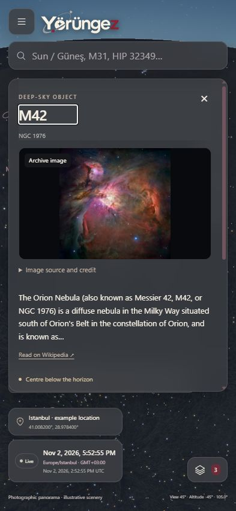

# TECH-11D / K-037 — Kaynaklı nesne görselleri ve yerel mobil önizleme

**2 Kasım 2026.** Kullanıcı bilgi, görsellik ve mevcut kartların UI/UX geliştirmesini öne aldı; yeni yedek/çöp/kişisel yaşam döngüsü işleri şimdilik ertelendi. Önceki çalışan kişisel kayıtlar kaldırılmadı. İz: **FR-02–03/FR-08–09/FR-11, UJ-01–02, AC-02–03/AC-11–13**. K-032 public deployment/DNS/HTTPS beklemesi sürer; yerel telefon denemesi yeni talep kapsamındadır.

## Görsel ve bilginin sunumu

Her nesne kartında görsel alanı bulunur. Öncelik kimliği bilinen, lisansı/atıfı doğrulanmış gerçek arşiv fotoğrafıdır. Önceki Güneş fotoğrafına Ay, yedi gezegen, Sirius, M31 ve M42 eklenerek **12 hedef** yerel fotoğrafla kapsandı. Yeni **11 JPEG / 1.293.299 byte** kaynak önizlemesi değiştirilmeden saklandı; üretken görsel kullanılmadı. Kaynak/üretici/lisans/URL/alınma tarihi/SHA-256/source SHA-1 [manifestte](../data/catalog/object-media.json), lisans ayrımları [katalog kaydında](../data/catalog/README.md) ve [üçüncü taraf envanterinde](../THIRD_PARTY_NOTICES.md) korunur. Alınma veya kaynak dosya tarihi çekim anı diye sunulmaz.

Diğer hedefler lisansı bilinen Commons fotoğrafını kullanabilir. Fotoğraf bulunmazsa/yüklenmezse aynı Worker karesindeki yatay koordinatlardan üretilen **hesaplanan gökyüzü kesiti** görünür; bunun fotoğraf olmadığı açıkça yazılır. Yeni efemeris veya rastgele yıldız konumu üretilmez. Kutupta azimutun saklanması korunur; doğrulanmış konum yoksa hedef çizilmez. **Bütün 5.073 yıldız/107 DSO için gerçek fotoğraf kapsaması tamamlandı iddiası yoktur.** Geniş kaynaklı atlas görselleri FR-03/A-005 olarak açıktır.

- Arşiv/işlenmiş fotoğraf seçili simülasyon anını, güncel evreyi veya çıplak göz görünümünü temsil etmez. Ay için güncel evre olmadığı doğrudan görünür; her fotoğrafın kaynağı/atıfı açılabilir. Neptün geliştirilmiş renktir; Sirius'un parlama çizgileri teleskop görüntüleme etkileridir.
- Kısa kaynak açıklaması fotoğrafın hemen ardından gelir; uzun metin/konum ayrıntıları açılabilir. İkincil pusula/defter eylemleri iki sütunda, kapat/başlık uzun kartta sabittir. Görsel alanı yüklenirken ölçüsünü korur. Görsel hatası haritayı veya hesabı engellemez.
- Yön hazır değilken yanlışlıkla “ufkun altında” yazılmaz. Bilinen eksik makale ile geçici servis hatası ayrılır; bilinen eksik makalede gereksiz tekrar düğmesi yoktur.
- Commons'ın açık public-domain beyanında lisans URL'si boş olabilir; bu durumda dosyanın lisans bölümü kaynak olarak kullanılır. Bilinmeyen haklar veya SVG bir nesne fotoğrafı gibi kullanılmaz. Atıf görüntülenen fotoğrafa aittir.
- M31/M42 için belirsiz NGC başlığı yerine Messier madde adı kullanılır. Tam nesne adı/kimliği önce gelir: **Mars, Marsic'ten önce**; `M 31`, `Messier31`, `NGC0224`, `HIP32349` desteklenir.
- Sabit Güneş makalesinin ilk özgün paragrafı gösterilir; Türkçe arşivin ikinci paragrafındaki hatalı km/s hız birimi yeniden yayımlanmaz. Ham arşiv değiştirilmedi. Fiziksel hız ölçeği için [NASA birincil kaynağı](https://science.nasa.gov/sun/facts/) esas alınır; düzeltilmiş gibi yeni sayısal iddia üretilmedi.



[Türkçe Ay fotoğrafı ve kaynak](ux/object-visuals/moon-credit-mobile-tr.jpg), [yatay görünüm](ux/object-visuals/moon-landscape-tr.jpg), [fotoğraf olmayan kaynaklı konum kesiti](ux/object-visuals/finder-desktop-en.jpg), [masaüstü Satürn](ux/object-visuals/saturn-desktop-en.jpg), [sunucusuz Satürn fotoğrafı](ux/object-visuals/saturn-offline-desktop-en.jpg).

## PWA ve doğrulama

**59 istemci testi, TypeScript ve üretim derlemesi geçti.** Yeni regresyonlar: fotoğraf hak/URL/MIME doğrulaması, bütün yerel fotoğraf hash/atıfları, kuzey geçişinde kesit ve kutup engeli, Mars/Marsic ve katalog kimlikleri. İlk CodeQL incelemesinin bulduğu çift HTML entity çözümleme düzeltilerek tek geçiş ve iç içe entity regresyonu eklendi; yeni derleme yeniden doğrulandı. Normal test/build dışarıdan bilimsel veri veya fotoğraf indirmez; fotoğraf yenileme yalnız `python scripts/science/prepare_object_media.py --refresh` ile açıktır.

Test edilen paket **`d1302ee3a9a1c169defa`**: **68 çekirdek dosya / yaklaşık 5,3 MiB**, **99 isteğe bağlı görsel / yaklaşık 13,9 MiB**. Yeni fotoğraflar çekirdeğe zorunlu indirme değildir. Hazırlanan genel görseller çevrimdışı açılır; ansiklopedi metinleri harici/isteğe bağlıdır ve offline garantili değildir. Kişisel kayıt/oturum/koordinat kalıcılığı eklenmedi.

IAB üretim önizlemesinde 12 hedefin doğru fotoğrafı, iki dil, 393×852/320×740/780×360 viewport ve masaüstü kontrol edildi. Yatay taşma görülmedi; uzun kartta başlık/kapat kaydırmaya rağmen erişilebilir kaldı. Önceki paketten açık güncelleme yapıldı, 99 görsel UI'dan hazırlandı; yalnız ajanın 5196 önizlemesi kapatılıp yeniden açılan haritada Satürn fotoğrafı doğrulandı, Wikipedia bağlantı hatası dürüstçe gösterildi. Önizleme yeniden başlatıldı. İşletim sistemi ağı, normal Web/API/Docker veya kullanıcı sekmeleri kapatılmadı. [Makine okunur kanıt ve sınırlar](science/object-visuals-qa.json).

## S23'te alan adı olmadan yerel deneme

Telefonun `127.0.0.1` adresi **telefonun kendisidir**. Ethernet PC ile Wi-Fi telefon aynı yerel ağdaysa PC'nin LAN IP'siyle erişim mümkündür; sunucunun o arayüze bağlanması, güvenlik duvarı ve ağdaki istemci izolasyonu uygun olmalıdır. **LAN HTTP yalnız arayüz denemesidir**; güvenli köken isteyen GPS/pusula/service worker/PWA kabulü değildir. Bu çalışmada LAN bind/firewall/router değişikliği yapılmadı; henüz hazır LAN URL'si yoktur. Gerçek yerel IP veya cihaz kimliği public belgeye yazılmaz.

Android için USB üzerinden **`adb reverse` → telefonun `http://localhost:5196`** kökeni kullanılabilir. Bu, bilgisayarın yalnız bir portunu zaten yetkilendirilmiş USB bağlantısıyla telefona taşır. Chrome/Android'in [resmî yerel sunucu rehberi](https://developer.android.com/develop/ui/views/layout/webapps/access-local-server), [Chrome port yönlendirme rehberi](https://developer.chrome.com/docs/devtools/remote-debugging/local-server) ve [PWA localhost geliştirme istisnası](https://developer.mozilla.org/en-US/docs/Web/Progressive_web_apps/Guides/Making_PWAs_installable). Public yayın, DNS, tünel veya sertifika uyarısı atlama gerekmez. iPhone için ADB yöntemi geçerli değildir; onun güvenilir HTTPS ortamı bekler.

1. PC'de üretim PWA önizlemesini açık tut. Bu paketin ajana ait önizlemesi 5196'dadır; geliştirme modu PWA kanıtı değildir.
2. S23'ü USB ile bağla. Geliştirici seçenekleri/USB hata ayıklamayı kullanıcı telefondan açar ve yalnız güvendiği PC için onayı kendisi verir. Ajan bu izinleri sessizce açmaz.
3. Resmî Android SDK `adb` komutu PATH'te olmalı. Depo kökünde PowerShell:

```powershell
./scripts/Connect-AndroidPreview.ps1 -Port 5196
```

4. Telefon Chrome'da **`http://localhost:5196/en`** veya `/tr` aç. Genel harita/arama/fotoğraf, dikey-yatay kullanım, katmanlar ve Bu gece/Takvim; sonra uygulamanın genel paket durumunu ve Chrome kurulum seçeneğini kontrol et. İzinli GPS/pusula sonuçları [DV protokolüne](cihaz-konum-pusula-dogrulamasi.md) göre ayrıca kaydedilir; güvenli köken sensör doğruluğu garantisi değildir.
5. Görselleri hazırlayıp yalnız test önizlemesini durdurarak sunucusuz açılışı dene. USB kablosunu çıkarmak localhost kökenini de erişilemez kılar; hazırlanmamış dosyalar beklenmez. Kişisel hesap/e-posta testinde BFF ve e-posta dönüş kökenleri ayrıca tutarlı yapılandırılmalıdır; bu paket bunları değiştirmez.
6. Test bitince yalnız bu yönlendirmeyi kaldır:

```powershell
./scripts/Connect-AndroidPreview.ps1 -Port 5196 -Remove
```

Yardımcı önce Yorungez paketini/tek yetkili cihazı/var olan port eşlemesini denetler; cihaz seri numarası yazdırmaz veya saklamaz. Başka porta ait eşlemeyi değiştirmez, `remove-all` kullanmaz. `-WhatIf` cihaz keşfi/yönlendirmesi yapmaz. PowerShell sözdizimi/WhatIf kontrolü geçti; **gerçek telefon bağlantısı/yönlendirme/kurulum/GPS/pusula henüz yürütülmedi**. Kullanıcının bağlantı yöntemi yanıtı ve telefondaki fiziksel adımlar bekler. [Cihaz oturum kartı](telefon-kabul-oturumu.md).

Sonraki mevcut iş: diğer nesnelerin doğru kimliğe bağlı kaynaklı fotoğraf/kısa fiziksel bilgilerini genişletmek ve gerçek S23 deneyiminin bulgularını uygulamak. Geniş olay türleri, veri yenileme, P2 ekipman ve önceki bilimsel kabul sınırları korunur; ertelenen yedek/çöp işleri bu önceliğin önüne geçmez.
