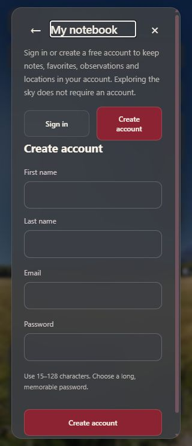
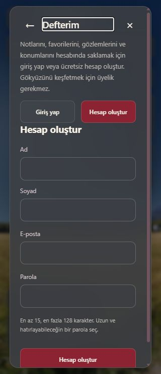

# TECH-11A / K-034 — İki dil ve klavye denetiminin ilk paketi

**2 Kasım 2026.** TECH-10 yerel kurtarma provası sonrasında, K-032 kapsamındaki yerel iki dil/erişilebilirlik işi başladı. İz: **FR-09/FR-11/FR-12, UX-01/UX-02, UJ-01/UJ-04/UJ-06, AC-11/AC-13/AC-14**. Bu ilk paket ortak seçimler, hesap görünümü ve tarih ızgarasını kapsar; tüm ürün veya WCAG 2.2 AA kabulü değildir.

## Bulunan ve düzeltilen davranışlar

- **Kapalı seçimde Home/End:** Dil listesini Home ile açarken ilk seçenek yerine seçili English odaklanıyordu. Ortak `SelectField`, Home ile ilk, End ile son seçeneği odaklar; yalnız odaklanmak değeri değiştirmez. Escape pencereyi kapatır ve seçimi koruyarak tetikleyiciye döner. Ay/saat/dil gibi aynı bileşeni kullanan listeler ortak düzeltmeyi alır; aramalı seçimde arama girdisi ilk odak olarak korunur.
- **Hesap görünümü değişirken kayıp odak:** Parolamı unuttum/geri dön gibi düğmeler form değişiminde DOM'dan kalkınca odak kayboluyordu. Başlık programatik odak alır; ilk açılışta üst dialog'un başlık odağı bozulmaz. Dil değişmesi tek başına yeni bir form görünümü sayılmaz. Giriş/kayıt düğmeleri etkin durumu `aria-pressed` ile bildirir; bölge görünür başlıktan adlanır ve bekleme durumu `aria-busy` ile ilişkilidir.
- **Parola açıklaması:** Mevcut 15–128 karakter yardım metni kayıt parolası girdisine `aria-describedby` ile bağlandı. Yeni metin, yeni parola kuralı veya varsayılan dil değişikliği yoktur; Türkçe/İngilizce metinler eşlidir.
- **Tarih klavye yardımı:** Mevcut oklar/Home/End/Page Up/Down/Enter/Escape açıklaması tarih ızgarasına `aria-describedby` ile bağlandı. UTC, IANA, simülasyon veya bilimsel hesap davranışı değişmedi.

## Kontroller ve sınırlar

Yerel **51 istemci testi**, TypeScript ve ayrı `.next-preview` üretim derlemesi geçti. Mevcut iki dil mesaj anahtarı/eşlik ve tarih gezinme testleri korundu. Basit ARIA/odak bağlantıları için uygulamayı kopyalayan yeni test düzeneği eklenmedi; gerçek üretim arayüzünde IAB klavye/DOM/erişilebilirlik ağacıyla kontrol edildi. TECH-10'un 127 .NET sonucu ayrı önceki paketin kanıtıdır; bu tur backend davranışı değişmedi.

İngilizce/Türkçe menü ve kayıt alanları, Home/End ve Escape, alt ay penceresinde Home/Escape, tarih yardım ilişkisi, giriş/kayıt/parola kurtarma başlıkları ve geri dönüş kontrol edildi. İki dilde 320 px kayıt formunda yatay taşma yoktu. Form gönderilmedi; gerçek SMTP, alıcı, hesap/parola veya kişisel konum kullanılmadı. Yalnız herkese açık İstanbul örneği vardı. Eski PWA paketinden kontrollü açık güncelleme ile geçildi; kullanıcıların normal uygulaması veya sekmeleri kapatılmadı.

[Makine okunur sonuç kaydı](science/keyboard-audit-qa.json).

## Kalan iki dil / erişilebilirlik işleri

- Gerçek ekran okuyucu, kontrastın bütün saydam yüzeylerde ölçümü, metin büyütme ve bütün kayıt/hata/boş/çevrimdışı yüzeyler için kapsamlı değerlendirme.
- Oturumlu Defterim ve hesap işlemlerinin kontrollü test e-postasıyla tam tarayıcı uçtan uca değerlendirmesi; bu pakette form gönderilmedi.
- Ayrı sözlük sayfası/terim derin bağlantıları ve tüm yüzeylerden terim erişimi.
- Gerçek görev oturumları, fiziksel dokunma, VoiceOver/TalkBack ve telefon performansı; HTTPS/deployment K-032 ile ertelendiği için ilgili cihaz kabulü bekler.

Bu açık işler [yerel çalışma planında](yayin-oncesi-yerel-plan.md) kalır; kota/kalıcı silme/içe aktarma ve P1/P2 kapsamı atlanmaz.

Referanslar: W3C [select-only combobox klavye örneği](https://www.w3.org/WAI/ARIA/apg/patterns/combobox/examples/combobox-select-only/) ve [button durumları/odak davranışı](https://www.w3.org/WAI/ARIA/apg/patterns/button/). APG örneğini okumak veya DOM kontrolü gerçek yardımcı teknoloji kabulü anlamına gelmez.
