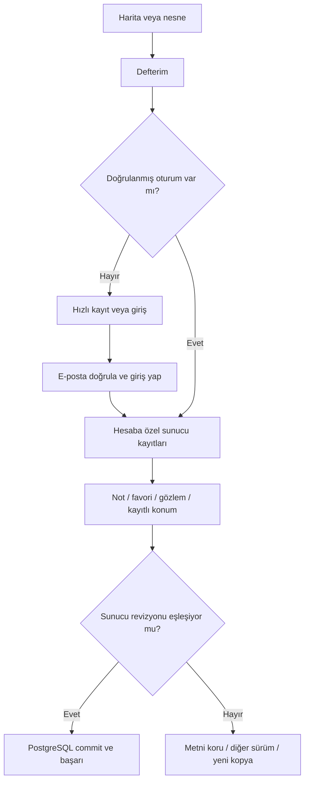

# UX-02 — Hesap zorunlu kişisel kayıt ve çevrimdışı keşif

**Güncel TECH-07 / K-027–028 (1 Kasım 2026):** Menüde giriş/kayıt veya doğrulanmış oturumun ad-soyadı; kayıt için ad/soyad/e-posta/parola. Servis hatası ve çevrimdışı durum ayrıldı, ortak yerel başlatıcı eklendi. Genel katalog/terim/takvim için hash doğrulamalı PWA paketi ve yeniden açılış uygulandı; kişisel kayıt/oturum/koordinat cache'e girmez. 125 .NET/44 istemci testi; fiziksel cihaz/üretim backup kabulü açık. [Uygulama ve kanıt](hesap-menusu-ve-cevrimdisi-gokyuzu.md), [hesap ADR](adr/0012-hesap-menusu-ve-ad-soyad.md), [PWA ADR](adr/0013-genel-gokyuzu-pwa-ve-cevrimdisi-paket.md).

**Güncel K-026 / TECH-06 (1 Kasım 2026):** Hesap envanterinde not/favori yanında ayrı gözlem ve kayıtlı konum uygulandı. Gözlem açıklama + kişisel beyan ister; gerçek zaman/nesne/konum isteğe bağlıdır, simülasyon zamanı kendiliğinden bağlanmaz. Konum kopyası geçmişi korur; haritada kullanım an/mod/hedef/kamerayı korur. 120 .NET + 38 istemci testi ve üretim derlemesi geçti; 52 tr/en terim/cache .7. [Uygulama ve sınırlar](gozlem-kayitlari-ve-kayitli-konumlar.md), [ADR-0011](adr/0011-gozlem-kaydi-ve-kayitli-konumlar.md). Fiziksel cihaz, genel katalog PWA/offline ve üretim backup kabulü açık; kişisel tarayıcı kalıcılığı yoktur.

**Güncel K-025 / TECH-05B:** Gönderen `sender@example.com`; parola yalnız özel kök `.env`, Gmail STARTTLS/AUTH kontrolü başarılı (ileti gönderilmedi). İşlem e-postaları İngilizce markalı HTML + düz metin, uygulama/API varsayılan dili İngilizce; açık Türkçe seçimi korunur. [Güncel paket](eposta-ve-varsayilan-dil.md). Önceki SMTP placeholder ve iki dilde e-posta hükümleri bu kararla değişti.

**K-024 / 31 Ekim 2026.** Kullanıcının son talimatı önceki anonim yerel Defterim kararını değiştirir. Kişisel envanter yalnız doğrulanmış hesapla PostgreSQL'de tutulur. [ADR-0010](adr/0010-hesap-zorunlu-defter-ve-sunucu-kayitlari.md), [uygulama ve kanıt](hesap-ve-sunucu-defteri.md). FR-06–07/FR-09/FR-11; UJ-04–05/UJ-07; AC-07–09/AC-12–13. Başlangıç arşivi ve eski ADR-0009 tarihsel kayıttır.

## Hesapsız keşif ve kaydetme kapısı

Gökyüzü, Bu gece, Takvim, arama ve sözlük için hesap gerekmez. Defterim veya nesne kartındaki kaydetme eylemi anonime hızlı kayıt/giriş açar. Menüye geri ok ve X ile haritaya dönüş vardır; konum/zaman/seçili hedef korunur. K-027 ile yeni kayıtta ad/soyad/e-posta/parola gerekir; eski hesaplar isimlerini tamamlayabilir. Parola 15–128 karakterdir; parola yöneticileri/otomatik doldurma alanları desteklenir.

Kayıt genel kabul yanıtı verir; doğrulama bekleme, yeniden gönderme ve girişe dönüş vardır. Doğrulanmadan giriş veya kişisel veri işlemi yapılamaz. Unutulan parola yanıtı hesap varlığını açıklamaz. E-posta linki token'ı fragment'te taşır; sayfa yüklenince adres temizlenir, açık doğrulama/sıfırlama düğmesi işlemi yapar. Geçersiz/süresi dolmuş token ve tekrar deneme açıklanır. K-025 özel Gmail ortamı hazırdır; otomatik/arayüz testi Mailpit/fake ile yürür, gerçek alıcıya test gönderilmez.

## Hesap Defterim

| Alan | Çalışan sözleşme |
|---|---|
| owner | Sunucu oturumundan gelen UserId; gövdedeki kimliğe güvenilmez |
| id / kind / revision | Not/gözlem/konum UUID, favori hedef kimliği; hesap + id anahtarı, PostgreSQL revizyon koşulu |
| body | Not/gözlem için boş olmayan en fazla 8000 karakter; kullanıcı içeriği çevrilmez/HTML yürütülmez |
| target | İsteğe bağlı sabit kimlik/ad snapshot; katalog adı seçili dilde bulunursa gösterilir |
| createdAtUtc / updatedAtUtc | Sunucunun sistem zamanı; gerçek gözlem anı sayılmaz |
| instantUtc | Nottaki ayrı kapalı başlayan kutuyla bağlanan harita anı; gözlemde yasak |
| observedAtUtc / observationConfirmed | Gözlemde ayrı opsiyonel gerçek an / zorunlu kişisel beyan; bağımsız doğrulama değildir, gelecek reddedilir |
| location | Ayrı kapalı başlayan kutuyla tam koordinat/varsa yükseklik/ad snapshot; otomatik GPS kalıcılığı yok |
| deletedAtUtc | Geri alınabilir çöp kutusu; kalıcı temizleme sonraki iş |

Düzenlenen kaydın bağları tarihsel snapshot olarak kalır. Harita bağlamı değişince eski not değişmez. Aynı favori aynı hesapta çoğaltılmaz. Diğer cihaz/giriş aynı sunucu kayıtlarını okur; başka hesap okuyamaz. JSON indirme taze sunucu listesinden yapılan açık dışa aktarmadır; uygulamanın JSON deposu değildir. İçe aktarma henüz yoktur.

Kaydedilmemiş taslak yalnız açık sayfa belleğindedir, panel/dil değişiminde korunur; yenileme sonrası kalıcılık vaadi verilmez. Commit yanıtı gelmeden başarı gösterilmez. Revizyon çakışmasında metin korunur; yeni kopya ya da liste yenileyip diğer sürümü inceleme vardır. Ağ zaman aşımında işlemin gerçekleşip gerçekleşmediği belirsiz olabilir; liste kontrol edilir. Aynı notun yeniden denemesinde id değişmez. Hesap değişimi eski hesabın taslağını yeni hesaba yazmaz; beklenen hesap başlığı sunucuda da denetlenir. Çıkış sunucu oturum ailesini iptal eder, özel bileşeni/bellek kayıtlarını kaldırır.

## Çevrimdışı ve kalan P0

Kişisel veri IndexedDB/localStorage/cache/service worker'a kalıcı yazılmaz; offline kişisel kuyruk veya anonim aktarım yoktur. Ağ yokken kişisel kayıt yükleme/yazma için bağlantı gereği görünür, taslak açık bellekte tutulabilir. Eski deneme IndexedDB'si okunmaz/aktarılmaz; mevcut veriler sessiz silinmez.

Genel astronomik katalog/hesaplama için PWA ve sürümlü çekirdek önbelleği hedefi sürer. ADR-0013 genel service worker/iki dil çekirdeği/kısmi görsel/sürüm güncellemesini uyguladı. İlk-ağ-yok ve önbellek-yok bağlantı gerektirir; dış Wikipedia/OSM offline değildir. Fiziksel kurulum/çok tarayıcı/eviction kabulü açık. OSM offline/bulk indirme yasağı korunur.

| İş | Durum / sıradaki somut çıktı |
|---|---|
| UX-02A/B | Hesap zorunlu favori/not, kayıt/giriş/doğrulama/sıfırlama/çıkış ve BFF oturumu uygulandı; üretim SMTP/işletim/backup kabulü açık |
| UX-02C / TECH-07 | Genel katalog PWA/offline yeniden açılışı, hash/cache/sürüm ve eksik görsel akışı uygulandı; sınırlı IAB kabulü. Fiziksel kurulum/çok tarayıcı kapsamı açık; özel kalıcı offline veri yok |
| DOM-01 / TECH-06 | Minimum gözlem/kayıtlı konum ve tarihsel konum kopyası uygulandı (ADR-0011); ileri bağlar/kalıcı temizleme/içe aktarma/kota açık |
| DEVICE | Fiziksel GPS/pusula/ekran okuyucu protokolü yürütülmedi; masaüstü/dar viewport bunun yerine geçmez |
| DATA-P1 | Ek meteor/asteroit/Ay–yıldız/tutulma kaynakları doğrulanacak; mevcut 2623 takvim olayı değişmedi |

KG-07/08 ve SN-P01–06/SN-D01–04 güncel hesap politikasına göre izlenir. Geliştirici testi gerçek kullanıcı araştırması değildir. [Bütün gereksinimler ve kalanlar](teslimat-izlenebilirligi.md).
