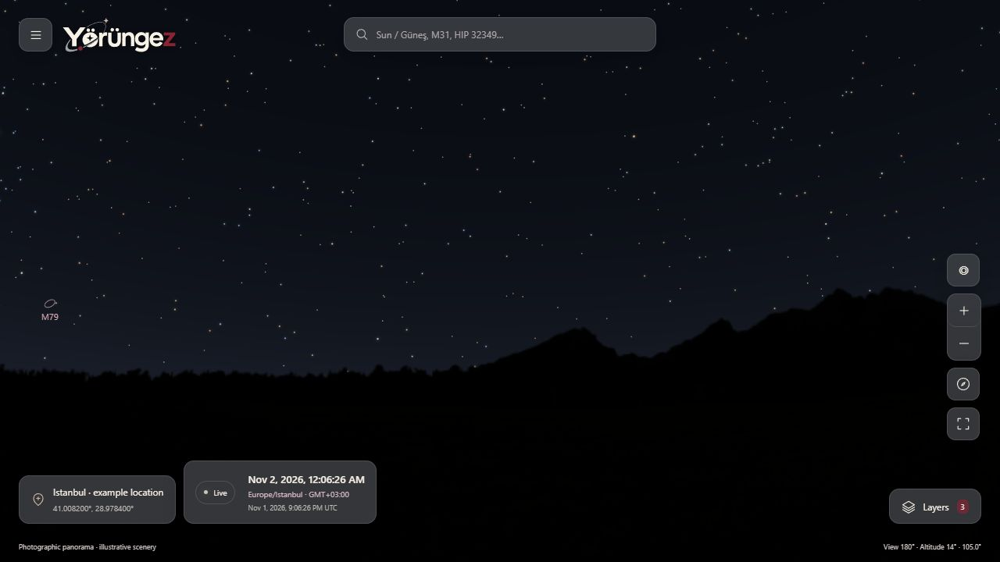
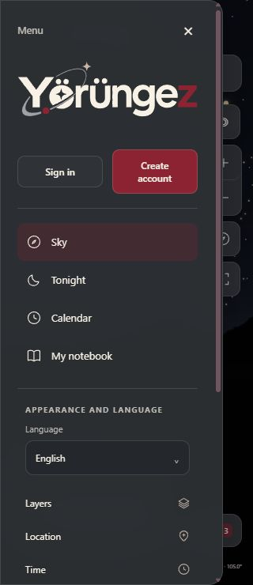

# TECH-09 — Marka logoları / K-031

**2 Kasım 2026.** Kullanıcının sağladığı dört logo web/PWA/favicon/işlem e-postalarında kullanılmak üzere bağlandı. [Kaynaklar, kullanım tablosu, hash envanteri ve kabul edilen üretim promptu](../data/branding/README.md) depodadır. Masaüstündeki orijinaller değiştirilmedi. FR-02, FR-07, FR-09 ve FR-11; UJ-01/UJ-04/UJ-07; AC-01/AC-07/AC-12/AC-13 ile ilişkilidir. Kapsam veya bilimsel hesap değişmedi.

## Uygulama

- Tam ekran haritanın yüzen başlığında, kapalı başlayan menüde ve e-posta doğrulama/parola yenileme sayfalarında ortak `BrandLogo` bileşeni. SVG gerçek harf biçimlerini korur; küçük ekranlarda oranı sabit, boyutu uyumludur. Alt metin iki dilde de ürünün teknik adı `yorungez`.
- Kullanıcının verdiği görsel **Yörüngez** yazımı korunur. Teknik ad, URL, manifest `id/name/short_name`, HTML başlığı ve erişilebilir ürün adı **yorungez** kalır. Bu, K-001'in teknik ad kararını değiştirmez; görsel varlık istisnasıdır.
- Favicon: açık zeminli amblem SVG, 16/32 PNG ve 16/32/48 ICO; standart kök favicon yolları da aynı içeriğe bağlı. Metadata içerik hash'li URL kullanır.
- PWA: kenardan kenara resimli 192/512 PNG `any`, ayrı 512 PNG `maskable`; Apple touch için 180 PNG. Maskable sürümün kritik şekilleri merkez güvenli dairenin içinde; arka plan opaktır. Tasarıma önceden cihaz köşe maskesi gömülmez.
- Bütün 12 web marka varlığı ve manifest genel hash doğrulamalı PWA çekirdeğinde. Nötr çevrimdışı hesap sayfası da yerel SVG'yi kullanır. Görsel proxy, sorgulu URL veya dış logo isteği yoktur. Önceki paketten geçiş, mevcut açık güncelleme/tek sekme korumasıyla yapılır.
- İşlem e-postasında açık zeminli logo PNG'si assembly'ye gömülü ve `multipart/related` CID kaynak olarak gönderilir; marka için dış indirme/izleme yoktur. İngilizce HTML+düz metin, güvenli işlem bağlantısı ve iki saat süre kuralı sürer. Gerçek alıcıya test iletisi gönderilmedi.
- Her iki README açık/koyu marka görselini gösterir. Kaynak palet, lisans ayrımı, katalog/atıflar ve hesap zorunlu sunucu kayıtları korunur.

## Kanıt

Yerel: **126 .NET testi**, **51 istemci testi**, TypeScript ve ayrı `.next-preview` üretim derlemesi geçti. Marka testleri kaynak/export SHA-256, boyut, SVG'nin dış bağımlılık içermemesi, ICO iç görselleri, opaklık ve maskable güvenli daire piksellerini doğrular. MIME testleri gömülü PNG'nin tekilliğini, CID/boyut sınırını, düz metin/HTML/fragment eşliğini ve logosuz eski düz iletinin gereksiz ek kazanmamasını doğrular. Yeni PWA üretim kontrolü hem manifest `purpose`/boyut yollarını hem HTML logo bağımlılıklarını denetler; bu yerel build'de **65 çekirdek dosya, 5,0 MiB**, 88 isteğe bağlı görsel vardır. Dosya sayısı build çıktısına bağlıdır.

IAB üretim önizlemesi: eski genel paketten açık düğmeyle güncelleme; 1280×720, 320×740, 393×852 ve 780×360 görünüm kontrolleri; SVG yüklenmesi/oranı ve yatay taşma kontrolü. Yalnız ajanın önizleme sunucusu durdurularak yeniden açılış ve marka görseli doğrulandı. Kullanıcının normal uygulaması kapatılmadı. Kullanılan İstanbul koordinatı herkese açık örnektir; gerçek GPS okunmadı.

## Sıradaki kabul

Fiziksel S23/Chrome ve iPhone 15/Safari kurulumunda simgenin OS maskesi, ana ekran, splash ve güncelleme davranışı [telefon oturumunda](telefon-kabul-oturumu.md) doğrulanacak. HTTPS test adresi henüz yok; bu görüntüler fiziksel cihaz kabulü değildir. Gerçek e-posta istemcilerinin görsel/dark-mode davranışı da açık kabul işidir. Önceki fiziksel GPS/pusula, performans, ekran okuyucu, veri doğrulama ve üretim backup işleri [yol haritasında](yol-haritasi.md) korunur.
