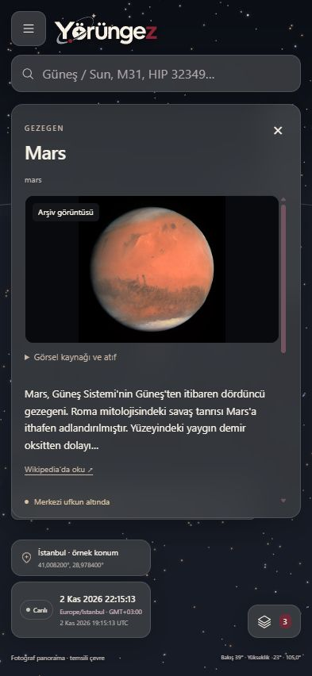
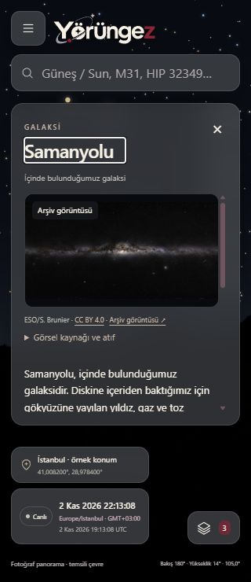

# TECH-11E / K-038 — Mobil kart, Samanyolu ve pusula erişimi

**2 Kasım 2026.** Kullanıcı S23'te Chrome ve Brave ile genel kullanımın, ayrıca PWA olarak ekleyip kullanmanın iyi çalıştığını bildirdi. Pusula çalışmadı; kullanıcı Chrome **Hareket sensörleri** ayarının engelli olduğunu doğruladı. Native uygulama bu izin sorununu çözmenin ön koşulu değildir. Fiziksel yön doğruluğu, GPS hata aralığı ve bütün DV protokolü bu bildirimle tamamlanmış sayılmaz. İz: **FR-01–03/FR-09/FR-11, UJ-01–02, AC-01–03/AC-11–13**. K-037 bilgi/görsel önceliği ve K-032 public yayın/DNS/HTTPS beklemesi sürer.

## Tek kart yüzeyi

Önceki saydam gövdeden ayrı opak `card-heading` arka planı/taşan gölgesi renk bloğu oluşturuyordu. Ortak `ObjectCardShell` başlığı kaydırılabilir gövdenin dışına taşır. Başlık ve gövde saydamdır; gri-bordo panelin arka planı bir kez boyanır. Böylece kaydırılan içerik başlığın altından geçmez ve kapat düğmesi sabit kalır. Mevcut kompakt kart/geri açma, fotoğraf/özet/sözlük/defter eylemleri korunur. Samanyolu bilgi kartı da aynı yüzeyi kullanır.

[Yatay görünümde kaydırılmış gövde ve erişilebilir başlık](ux/mobile-followup/card-landscape-tr.jpg). 320×740, 393×852 ve 780×360 IAB viewport kontrollerinde yatay taşma görülmedi; başlık ve gövdenin hesaplanan arka planları `rgba(0,0,0,0)`, ortak panel `rgba(60,63,67,0.76)` idi. Bu ölçümler fiziksel dokunma testi değildir.

## Samanyolu araması

`Samanyolu`, `Samanyolu Galaksisi`, `Milky Way` ve `milkyway` aynı **geniş gökyüzü özelliğini** açar. [Tek kaynak kaydı](../data/catalog/sky-features.json) iki dilde özgün kısa açıklama, ad/alternatif adlar ve NASA kaynaklarını taşır; yıldız/DSO efemerisine sahte nokta eklenmez. Galaksimizin içindeyiz; bütün galaksiye tek RA/Dec/azimut/yükseklik veya doğuş/batış saati atanmaz. Yay bölgesine geçiş mevcut `con-sgr` şematik takımyıldızını açar; tüm galaksinin kesin merkeziymiş gibi sunulmaz. Haritaya Samanyolu fotometrik katmanı eklenmiş değildir.

Andromeda takımyıldızı ve M31 ayrı nesnelerdir. Arama, M31 için **“M31 · Andromeda Galaxy / Andromeda Galaksisi”** yazar; Türkçe tam galaksi adı da eşleşir. M31'in mevcut kimliği, koordinatları ve kaynakları değişmedi.

Samanyolu kartı **ESO/S. Brunier**, [eso0932a](https://www.eso.org/public/images/eso0932a/), [CC BY 4.0](https://creativecommons.org/licenses/by/4.0/) panorama önizlemesini kullanır. **155.879 byte** kaynaktan sağlanan JPEG değiştirilmedi; hash/alınma zamanı/kaynak/lisans kayıttadır. ESO kredisi fotoğrafın altında her zaman görünür; açılır ayrıntıya gizlenmez. Yalnız screensize önizleme dağıtılır; sayfadaki kısıtlı 800 milyon piksellik orijinal alınmadı. Görüntü farklı zamanların birleşimidir; canlı çekim, dışarıdan tüm galaksi görünümü veya çıplak göz parlaklığı değildir. [Hak kaynağı](https://www.eso.org/public/outreach/copyright/). Yenileme yalnız `python scripts/science/prepare_milky_way.py --refresh`; normal test/build indirme yapmaz.

## Web pusulası ve yerel tanı

Web, güvenilir kökende ve kullanıcı izin verdiğinde cihaz yön verisine erişebilir. Kurulum, tek başına sensör izni vermez. [W3C yön standardı](https://www.w3.org/TR/orientation-event/), [Chrome izin rehberi](https://support.google.com/chrome/answer/114662?co=GENIE.Platform%3DAndroid&hl=tr). Bu oturumda güvenilir telefon localhost'u USB üzerinden kullanıldı; PWA ile GPS/pusula aynı izin değildir. İzin ve sensör donanımının varlığı doğru/gerçek kuzey ölçümü garantisi değildir.

Kullanıcıya yalnız bu site için Hareket sensörleri erişimini kontrol etmesi, izin vermeyi seçerse sayfayı yenileyip pusulayı yeniden başlatması söylendi. Tarayıcı korumaları veya telefon güvenlik ayarları ajan tarafından değiştirilmedi; sensör engeli sessizce aşılmadı.

Başlat eyleminden sonra açılabilir tanı, güvenilir köken, yön desteği, izin isteği sonucu, tarayıcının bildirdiği sensör izinleri ve son gelen verinin sınıfını gösterir. Desteklenmeyen izin sorgusu **bilinmiyor** kalır; engelli sayılmaz. Ham sensör akışı, GPS, cihaz kimliği veya hata metnindeki özel bilgiler kaydedilmez/gönderilmez. İzin hatası yalnız izinli hata sınıfı etiketiyle gösterilir. Verinin düz telefon için kullanılabilir, eğik, göreli veya geçersiz olması ayrılır. Göreli alpha hâlâ gerçek kuzey diye kabul edilmez.

İzin isteği kullanıcı tıklamasında **asenkron tanı sorgularından önce** çağrılır; mevcut kullanıcı eylemi bağı korunur. Kapat/gizle/yeniden başlat eski izin ve tanı yanıtlarını geçersiz kılar. Önceki 35° düz tutma sınırı, kötü sapma reddi, 8 s eski veri temizliği ve açık gerçek yön hizalaması korunur. Bu araç arka kamera AR yönü veya otomatik sürekli harita takibi değildir.

## Kanıt ve kalan kabul

**62 istemci testi**, tip kontrolü ve üretim derlemesi geçti. Yeni regresyonlar: bilinmeyen/engelli/izinli sensör sorguları, özel hata metni dışlama, göreli/eğik/geçersiz veriden kuzey icat etmeme, iki dilli Samanyolu araması/tek kimlik, doğru mevcut bölge bağlantısı ve ESO fotoğraf SHA/byte/atıfı. Astronomi motoru, katalog noktaları ve zaman modeli değişmedi.

Paket **`2d7195b7d24710660484`**: 68 çekirdek dosya / yaklaşık **5,3 MiB**, 100 isteğe bağlı görsel / yaklaşık **14,1 MiB**. 13 yerel fotoğraf hedefi vardır; bütün katalog için fotoğraf kabulü değildir. IAB'de genel görseller 100/100 hazırlandı; yalnız ayrı 5197 QA önizlemesi durdurularak Türkçe Samanyolu araması, metin, ESO fotoğrafı ve atıfı sunucusuz açıldı. [Kanıt](ux/mobile-followup/milky-way-offline-tr.jpg). Kullanıcının telefonuna yönlenen 5196 sunucusu bu offline denemede açık kaldı; QA önizlemesi de yeniden başlatıldı.

IAB tanısı güvenilir localhost, izinli erişim ve yalnız göreli veri durumunu ayrı gösterdi; kullanılabilir kuzey diye sunmadı. Fiziksel sensör sonucu olarak raporlanmaz. [Makine okunur kayıt](science/mobile-followup-qa.json). S23'te izin açıldıktan sonra gerçek pusula/hizalama/yön sapması/eskime; gerçek GPS hata aralığı; sürümleriyle tam Chrome/Brave/PWA offline/yeniden açılış protokolü ve iPhone 15/Safari kabulü açık kalır. Kullanıcının olumlu genel bildirimi bu tekil kabul işlerinin yerine geçmez.
