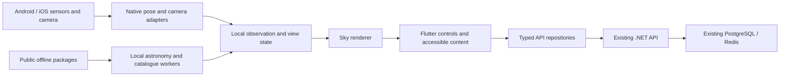

# 01 — Architecture and product contract

**Status:** confirmed direction plus recommended architecture. **Traceability:** K-039, K-046–048; FR-01–12; UJ-01–07.

## Confirmed product direction

Flutter is the mobile framework for Android and iOS. The application is free to use and advertising-free. It provides online and offline sky exploration, shares accounts and personal inventory with the existing backend, and supports English and Turkish equally, with English as the initial default. The existing Web/PWA remains a supported client and continues to improve.

Flutter compiles an application for the target platforms and can call their native APIs. Shared Flutter UI does not mean every control is an Android/iOS system widget, and it does not remove the need for Swift/Kotlin integration. Native host APIs are expected for the precision-sensitive parts. See [Flutter platform integration](https://docs.flutter.dev/platform-integration/ios/apple-frameworks).

## Ownership boundaries

| Concern | Existing/shared system | Recommended mobile ownership |
|---|---|---|
| Identity and inventory | .NET Identity/Notebook modules, PostgreSQL, account ownership/revisions | Bearer-token session adapter, secure refresh credentials, in-memory views |
| Preferred language | Account field and `/api/v1/auth/language` | Same preference after authentication; offline public UI can retain a non-sensitive local language setting |
| Astronomy | Existing C#/JS models and independent references | Local computation adapter, matching units/frames/model version |
| Catalogue and explanations | Canonical `data/`, licences, stable IDs, source manifests | Versioned general offline packages; indexed local reads |
| Phone orientation and camera | Web-specific adapter is an existing reference | OS-fused pose, lens metadata, lifecycle and permission adapters |
| Rendering | Current Web renderer and domain concepts | Flutter renderer behind an interface selected by device experiments |
| Place names and zones | GeoNames service; timezone logic partly in Next.js | Initially shared API; explicit offline subset/boundary data if packaged |
| Weather and changing external data | Provider ingestion/cache to be developed | Fetch prepared snapshots and expose freshness/availability |

Do not duplicate the user database, deploy a second identity provider or copy Redis/PostgreSQL into the phone. The mobile client calls the API rather than opening a database connection. PostGIS remains conditional for Earth-based observing-site analysis, not a sky-rendering dependency.

## Recommended module structure

Use feature modules for Sky, Object Atlas, Tonight, Calendar, Account and Notebook. Put pure types and rules in a small domain layer; use repositories/use cases for API, content and calculation work. Keep Flutter widgets, SQL, camera objects and platform exceptions outside pure astronomy/domain types. Avoid mechanically reproducing every server CQRS layer in Dart.

Proposed interfaces: `ObserverRepository`, `AstronomyCalculator`, `PoseSource`, `CameraSession`, `SkyRenderer`, `CatalogueRepository`, `ContentPackageStore`, `AccountRepository` and `NotebookRepository`. These are design proposals, not existing Dart classes.

Recommended flow:

Keep the high-rate pose/render path on the device. Network latency is not an acceptable dependency for turning the phone. Separate sensor sampling, astronomical recomputation, tile loading and UI repaint cadence. The exact frequencies and thread boundaries require profiling.

## Existing backend inventory and gaps

Repository inspection found versioned catalogue, overlay, calendar, place search, positions/horizon crossings, authentication, language and notebook endpoints. Bearer authentication exists alongside the browser path. `v1` is already present; adding another version prefix is not the task.

OpenAPI generation and a tested mobile client contract remain preparation work. Next.js currently owns some timezone and object-content behaviour, so a mobile app cannot simply call every Web route as though it were a complete .NET service boundary. Document and consolidate reusable contracts first. See [current mobile/backend audit](../../web-tamamlama-ve-ortak-backend-mobil-hedef.md), [account language contract](../../account-language-preference.md) and [existing endpoint definitions](../../../src/Yorungez.Api/Http/Endpoints.cs).

## Choices still requiring evidence

Renderer backend, astronomy C binding versus Dart port, OS support floor, full offline timezone lookup, optional local event reminders and exact performance budgets remain unresolved. General offline support preserves the existing account-required/server-owned personal-record policy. An offline write queue or durable personal cache would require a separate product decision about privacy, conflicts and sign-out cleanup.

A native application does not inherit Web performance evidence automatically. The S23 and iPhone 15 are first acceptance devices, followed by less capable hardware; neither represents all supported devices.
