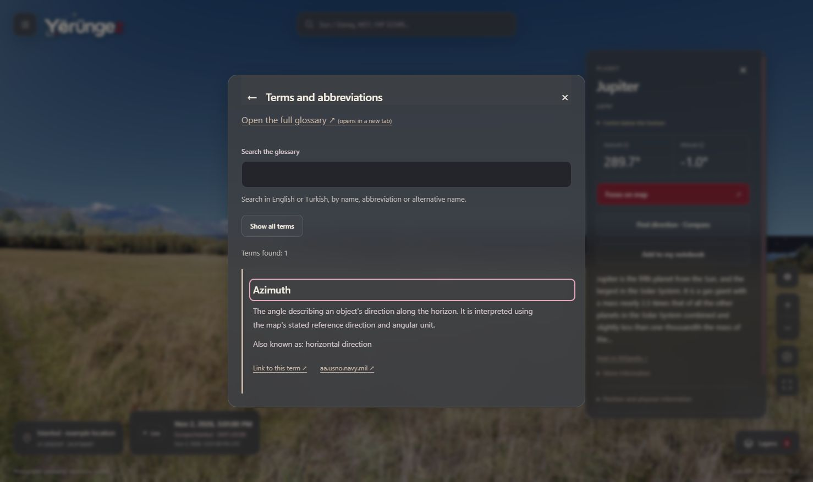
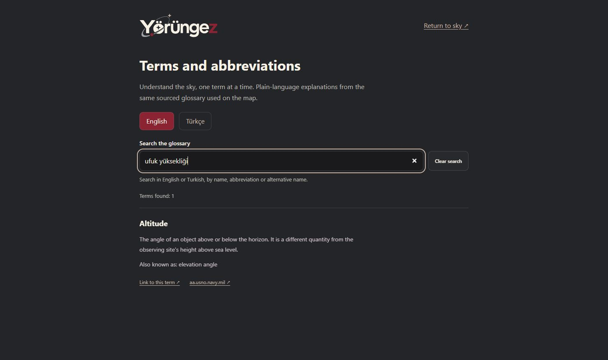

# TECH-11C / K-036 — Mevcut sözlük deneyimini derinleştirme

**2 Kasım 2026.** Kullanıcı mevcut işlevlerin derinleştirilmesini önceliklendirdi. Yeni ürün alanı açılmadan, yerel planın iki dil/erişilebilirlik sırasındaki sözlük ve terim bağlantıları geliştirildi. İz: **FR-11–12/FR-09, UJ-02/UJ-07, AC-11–14**. Önceki FR/UJ/AC kapsamı, bilimsel sınırlar ve K-032 deployment/HTTPS beklemesi korunur.

## Aynı içerik, tutarlı erişim

Harita penceresi ve ayrı sözlük sayfası ortak `GlossaryBrowser` kullanır. Kaynak hâlâ backend Catalog modülünün aynı **52 Türkçe/İngilizce terimi**dir. Tanımlar, kaynak URL'leri, sabit kimlikler, içerik/cache sürümü `2026-10-31.7` ve astronomik model değiştirilmedi. İkinci bir bilimsel içerik kopyası üretilmedi.

- Arama, gösterim dilinden bağımsız olarak iki dildeki ad/alternatif ad/kısaltma/kimlikleri tarar. Türkçe karakterler, büyük/küçük harf ve birden fazla boşluk desteklenir; tam eşleşmeler önce, kalanlar seçili dile göre sıralanır.
- Karttan terim açmak artık arama metnini doldurmaz; **tam olarak ilgili terimi** seçer, başlığını odaklar. Tüm terimler düğmesi aramaya döner. Escape aynı kartın yardım düğmesine döner; hedef ve zaman modu korunur.
- Görünür arama etiketi/yardımı, sonuç sayısı, boş sonuç, temizleme ve eksik bağlantı açıklaması iki dilde eşlidir. Temizleme düğmesi kaybolurken odak arama girdisine döner. İlk açılıştaki hash okuması, o sırada yazılmaya başlanmış aramayı temizlemez.
- Yalnız ilk kaynak yerine **bütün kaynaklar** gösterilir; örneğin pusula hem NOAA hem W3C kaynağını taşır. Kaynak eylemleri anlamlı erişilebilir ad ve yeni sekme açıklaması taşır. Ad veya kısaltmayla aynı olan alternatif ad satırı gereksiz yere tekrarlanmaz; içerik kaynağından silinmez.

## Ayrı sayfa ve bağlantı sözleşmesi

Genel, hesap gerektirmeyen sayfalar **`/en/terms`** ve **`/tr/terms`**. Sabit bağlantı örneği **`/tr/terms#term-azimuth`**. Kimlik iki dilde aynıdır; çevrilen ada göre kırılgan URL üretilmez. İki statik sayfa kullanılır; her terim için ayrı HTML/veri indirme bağımlılığı eklenmez.

Doğrudan bağlantı ve hash değişimi ilgili başlığı odaklar ve görünür alana getirir. Dil bağlantısı aynı terimi korur. Tarayıcı geri/ileri navigasyonu hash seçimini geri yükler. Arama başlatmak hedef seçimini kaldırır; arama taslağı URL'ye veya tarayıcı kalıcılığına yazılmaz. Eksik/bozuk hash hata fırlatmaz; kullanıcıya açıklanır ve bütün terimler aranabilir kalır. Haritadaki ayrı sayfa/terim bağlantıları yeni sekmede açılarak mevcut haritanın bellekteki bağlamını korur.

Sayfa `h1 → h2`, harita dialog'u `h2 → h3` başlık düzenini kullanır. Sözlükte iç içe iki kaydırma kutusu kaldırıldı; sayfa/dialog kendi yüzeyinde kayar. Uzun panelde geri/kapat başlığı sabit kalır; 52 terimli listenin sonuna klavyeyle gidildiğinde de erişilebilirdir. [Son terimde başlık kanıtı](ux/glossary/long-panel-header-en.jpg). Uzun başlık/kısaltma ve kaynak adresleri dar ekranda kırılır. Kaynak/terim bağlantılarının dokunma yüksekliği en az 44 px; arama yazısı 16 px'tir.

[Türkçe 320 px doğrudan WCS bağlantısı](ux/glossary/term-320-tr.jpg), [sunucu kapalıyken İngilizce 320 px arama](ux/glossary/offline-320-en.jpg).

## Genel PWA ve mahremiyet

`build-offline.mjs`, iki sözlük HTML'ini ve derleme bağımlılıklarını mevcut SHA-256/byte çekirdek envanterine ekler; her HTML'in statik bağımlılıkları derlemede doğrulanır. Test edilen yerel paket **`f6cf8fe82ae8ce0ff320`**, **68 çekirdek dosya / yaklaşık 5,2 MiB**; önceki TECH-11B yaklaşık 5,1 MiB idi. İsteğe bağlı 88 görsel/12,7 MiB değişmedi.

Önbellek yalnız açık envanterdeki genel GET kaynaklarını kapsar. Sorgulu URL, RSC, POST, kişisel kayıt, oturum ve koordinat önbelleği eklenmedi. Aynı iki dildeki tanımlar statik HTML'de bulunur; arama istemcide çalışır. Sözlük kendi başına yeni PWA kaydı başlatmaz; ilk hazır haritadan sonraki mevcut kayıt/güncelleme sözleşmesi korunur. İlk ziyaret/paket hazırlanmamışsa bağlantı gereksinimi sürer.

## Doğrulama ve açık kabul işleri

**55 istemci testi**, TypeScript ve ayrı üretim derlemesi geçti. Mevcut offline testleri iki sözlük sayfasının sunucusuz açılışını ve sorgu/RSC dışlama sınırını kapsayacak şekilde genişletildi. Yeni testler iki dilde çapraz arama/kısaltma/Türkçe karakterler, bütün 52 sabit kimliğin bağlantı dönüşümü, bozuk hash ve yeni metin anahtarlarının dil eşliğini doğrular. [UI sonuç kaydı](science/glossary-qa.json).

IAB üretim arayüzünde masaüstü/320 px, iki dil, doğrudan terim odağı, boş sonuç, temizleme, eksik terim, geri/ileri, dilde kimlik koruma ve kaynaklar kontrol edildi. İlk açılışa hemen yazılan arama son derlemede korunuyordu. Harita kartındaki Azimut → Escape dönüşünde Jüpiter ve canlı mod korundu. Eski genel PWA paketinden açık güncelleme/yeniden açma ile geçildi. Hazır çekirdekten sonra yalnız ajanın önizleme sunucusu durduruldu; Türkçe pusula bağlantısı, iki kaynak, İngilizce/Türkçe arama ve dil geçişi yeniden açılarak çalıştı. Önizleme yeniden başlatıldı. OS ağı/API kapatılmadı; harici kaynak sayfalarının çevrimdışı olduğu iddia edilmez. Gerçek hesap/form/e-posta/kişisel GPS kullanılmadı; normal uygulama ve kullanıcı sekmeleri kapatılmadı.

Bu paket FR-12'nin ayrı sayfa/derin bağlantı kalanını uygular; **tam WCAG veya bütün FR-11/AC-14 kabulü değildir**. Gerçek ekran okuyucu, tüm saydam yüzeylerde kontrast/büyütme, oturumlu hesap/defter hata-boş akışları için kapsamlı iki dil E2E, gerçek dokunma ve kullanıcı değerlendirmesi açık kalır. Sonraki yerel iş bu mevcut yüzeylerin okunabilirlik/klavye/odak sınırlarını derinleştirmektir; ardından plandaki kayıt yaşam döngüsü ve performans ölçümü sürer. P1 veri yenileme/olay/atlas ve P2 ekipman hedefleri korunur, bu pakette eklenmedi.
