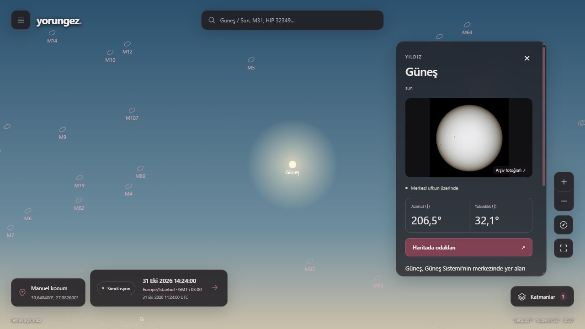

# TECH-04 — Tam ekran planetaryum ve konum/zaman düzeltmeleri

**Sonraki güncel paket:** [TECH-04C çizelge/takvim/yer adı/saydam geniş açı](gozlem-cizelgesi-ve-takvim.md). Aşağıdaki sayılar ve ekranlar bu belgenin kendi aşamasının tarihsel kanıtıdır; yeni kapsam ve kalanlar güncel kayıtta tutulur.

**Sonraki aşama notu:** Bu paketin 39 terim/19 istemci testi ve ilk temsili arazi kanıtı tarihsel olarak korunur. Kullanıcı paleti/dil listesi/doğal fotoğraf çevre ve düz pusula, 43 terim/24 istemci testi [TECH-04B kaydındadır](dogal-gorunum-ve-pusula.md). Fiziksel cihaz kabulü açık kalır.

31 Ekim 2026 kullanıcı talimatı; mevcut FR/UJ/AC kapsamına ek uygulama paketi. Önceki MVP/P0/P1/P2 ve kişisel veri/kimlik/offline hedefleri korunur. Bu dosya uygulama sırasında güncellenir; aşağıdaki hedefler başlangıçta doğrulanmış sonuç değildir.

- Başlangıçta takılma: katalog/Worker yaşam döngüsünde süre sınırı, hazır sinyali, tek etkin hesap/en yeni bekleyen bağlam, görünür yeniden deneme; bilimsel doğrulama ve eski yanıt koruması korunur.
- Tam ekran harita; kalıcı topbar/sidebar kaldırılır. Sol menü başlangıçta kapalı, kontroller ve nesne kartı saydam katmanlardır. Gri/bordo tema; dört ana bölüm ortak menüde kalır.
- Katmanlar: takımyıldız çizgi/adları, takımyıldız çizimleri, atmosfer, temsili açık arazi, azimutal ve ekvatoral ızgara, derin uzay, gece görünümü, tarayıcı tam ekranı. Atmosfer/arazi/derin uzay başlangıçta açık; diğerleri kapalı.
- Arazi/atmosfer görsel simülasyondur; gerçek Balıkesir topografyası, meteoroloji veya ışık kirliliği diye sunulmaz. Göksel hesaplar gözlem konumu ve aynı UTC anına dayanır; çizim katmanları hesap sonucunu değiştirmez.
- İzin zaten verilmişse yüksek doğruluk isteğiyle güncel cihaz konumu alınır. Yeni izin kullanıcı eylemiyle; ret/ulaşılamama/süre aşımı/manual seçim korunur. Doğruluk metre ve ölçüm zamanı ayrı tutulur. Harita nokta seçimi koordinatları düzenler; GPS hassasiyeti arttı diye sunulmaz. Harici Dünya haritası yalnızca açık kullanıcı eylemiyle yüklenir.
- Konuma göre IANA saat dilimi, yerel tarih/saat + GMT ofseti ve aynı anın UTC karşılığı birlikte görünür. Yerel/UTC giriş seçilebilir; DST boş/çift saatleri sessizce normalize edilmez. Konum/dil/saat dilimi değişimi seçili UTC anını değiştirmez.
- Güneş/Sun dahil nesne kartında gerçek kaynaklı görsel, kısa Wikipedia açıklaması, kaynak/atıf/tarih, hesaplanan yön/yükseklik ve uygun fiziksel alanlar. Ayrıntılar isteğe bağlı açılır; ansiklopedi yanıtı haritayı engellemez. Kimlik eşleşmesi belirsizse yanlış makale gösterilmez.
- Fare sürükleme, tekerlek/trackpad zoom, klavye, dokunma ve dar ekran yerleşimi doğrulanır. Fiziksel cihaz/gerçek GPS doğruluğu ve ekran okuyucu denemeleri geliştirici simülasyonundan ayrılır.

İz: FR-01–05/08–09/11–12; UJ-01–03/06; AC-01–06/09–14; A-002/005/007/009/014. Katalog/çizim lisansları, bağımsız referanslar, belgenin başlangıç arşivi ve önceki kutup yön sınırı korunur.

## Uygulanan paket — 31 Ekim 2026

**Durum:** Yerel üretim derlemesinde aşağıdaki akışlar çalışır. MVP-0 veya bütün ürün kabulü tamamlandı değildir. Karar [ADR-0005](adr/0005-tam-ekran-konum-ve-yerel-zaman.md), kalan işler [izlenebilirlik tablosundadır](teslimat-izlenebilirligi.md).

### Açılışta bekleme

Önceki kullanıcı oturumunun ayrıntılı kaydı yok; o tek olayın kesin nedeni kanıtlanamıyor. Kodda süresiz katalog beklemesi ve Worker yaşam döngüsü/üst üste canlı hesap istekleri için koruma eksikleri giderildi. Katalog isteği 10 saniyeyle sınırlı; Worker hazır sinyali verir, bir etkin iş ve yalnızca en yeni bekleyen bağlam tutulur. Canlı saat meşgul işçiye kuyruk biriktirmez. 8 saniyelik işçi gözetimi aynı gerçek astronomi hesabını ana iş parçacığında yeniden çalıştırır; başarısızlık görünür hata/yeniden deneme olur. Eski yanıt yeni bağlamın üzerine yazamaz. Wikipedia, GPS ve saat dilimi haritanın açılışını bekletmez.

`/api/catalog` aynı hash doğrulamalı yerel yıldız/overlay/iki dilli terim paketini sunar; ilk kare backend erişimine bağlı değildir. Veri/şema/terim hash'leri ETag'e dahildir. Geliştirme sunucusunun ilk derlemesi ayrıca zaman alabilir; kullanıcı deneyimini değerlendirmek için üretim komutu kullanılır.

### Harita ve içerik

Kalıcı üst/yan çubuk kaldırıldı. Tam viewport harita, başlangıçta kapalı sol menü, gri/bordo kontroller ve saydam nesne kartı var. Gökyüzü/Keşfet/Olaylar/Defterim omurgası korunur; uygulanmamış bölümler tamamlanmış gibi sunulmaz. Fare sürükleme, yumuşak tekerlek/trackpad zoom, klavye, pointer/pinch desteği vardır; görüş alanı 0,6–120°, kamera yüksekliği −90–90° olabilir. Mobilde “Haritada odakla” kartı küçültür, ayrıntı tekrar açılabilir.

| Anahtar | İlk durum | Kapsam |
|---|---|---|
| Takımyıldız çizgi/adları | Kapalı | 88 figür |
| Takımyıldız çizimleri | Kapalı | Johan Meuris kaynaklı 85 gerçek illüstrasyon; üçü bu pakette yok |
| Atmosfer | Açık | Güneş yüksekliğine bağlı temsili görsel |
| Arazi | Açık | Açık alan hissi veren temsili düz arazi |
| Azimutal ızgara | Kapalı | Yerel yön/yükseklik ağı |
| Ekvatoral ızgara | Kapalı | Açıkça J2000 etiketli ağ |
| Derin uzay | Açık | OpenNGC'den 107 Messier eşleşmesi |
| Gece görünümü | Kapalı | Görsel renk filtresi |
| Tarayıcı tam ekranı | Kapalı | Desteklenen tarayıcıda giriş/çıkış |

Çizim katmanları astronomik konumu değiştirmez. Atmosfer gerçek hava/kırılma modeli, arazi gerçek GPS topoğrafyası değildir. Derin uzay paketi tam Messier listesi değildir: M40, M45, M102 eksiktir. Çizimler `con-pup`, `con-ser`, `con-vel` için eksiktir; sahte görsel üretilmedi. Kaynak commit'leri, hash'ler, lisanslar ve üretim adımları [katalog rehberinde](../data/catalog/README.md) ve [bağımlılık envanterinde](../THIRD_PARTY_NOTICES.md).

Güneş/Sun kartında gerçek beyaz ışık fotoğrafı, tr/en Wikipedia özeti, kaynak bağlantısı ve isteğe bağlı ayrıntı/konum alanları vardır. Fotoğraf **arşiv fotoğrafıdır**, canlı gözlem değildir. Atıf, ayrı metin/görsel lisansı, revizyon ve alınma tarihi saklanır; alınma tarihi fotoğrafın çekim tarihi diye sunulmaz. Görsel Matúš Motlo/Commons CC BY-SA 4.0; metin Wikipedia CC BY-SA 4.0. Güneş özeti/fotoğrafı hash doğrulanan yerel pakettedir. Diğer bilinen nesnelerin Wikipedia/Commons bilgisi süre sınırlı BFF üzerinden isteğe bağlı alınır; eksik/belirsiz makale veya lisans bilgisi varsa uydurulmaz ve sessiz İngilizce fallback yapılmaz. Kısa özet önde, tam metin/kaynak ve konum ayrıntıları açılabilir. RA/Dec ve uzaklık uygun Güneş Sistemi hedeflerinde gözlemciden hesaplanır; bilinmeyen koşullar belirtilir.

### Konum ve zaman

İzin önceden verilmişse güncel `enableHighAccuracy` ölçümü otomatik istenir. Yeni izin yalnızca “Konumumu kullan” eylemiyle istenir. Ölçüm doğruluğu/metre, zaman ve kaynak korunur; ret, destek yokluğu, ulaşılamama ve süre aşımı açıklanır. Bu tek taze ölçümdür, sürekli arka plan takibi değildir. Manuel düzenleme geç gelen GPS yanıtını iptal eder. Doğrulanmamış cihaz yüksekliği deniz seviyesi yüksekliği olarak kullanılmaz; bilinmeyen yükseklik için önceki açık 0 m varsayımı korunur.

Kullanıcı isterse Leaflet/OpenStreetMap Dünya haritasını açıp nokta veya klavye ile koordinat seçer. Tam hassasiyet tutulur, ekranda okunabilir basamaklar gösterilir. Harici döşemeler ancak bu açık eylemden sonra istenir; döşeme alanı OSM sağlayıcısına görünür. Atıf görünürdür; toplu/offline döşeme indirme yoktur. Google hesabı/ücretli anahtar zorunluluğu eklenmedi.

Saat dilimi `POST /api/location/time-zone` üzerinden sunucudaki kapsamlı `geo-tz/all` poligonlarıyla bulunur. Konum dış coğrafi servise otomatik gönderilmez, URL/storage/log'a eklenmez; yanıt `no-store` olur. İstemci koordinatı yalnızca bu çözümleme için aynı kökenli BFF'ye gönderir. Sınırda birden fazla bölge/hata varsa belirsizlik açıklanır ve UTC/elle IANA seçimi sunulur. IANA bölgesi, yerel tarih/saat, GMT ofseti ve aynı anın UTC karşılığı birlikte gösterilir. Dil/bölge/konum değişimi seçili UTC anını değiştirmez.

**Balıkesir örneği: 31 Ekim 2026 14:24 Europe/Istanbul (GMT+03:00) = 11:24 UTC.** Yerel/UTC giriş ayrı seçilebilir. Temporal boş yaz saati saatlerini reddeder, tekrarlanan saat için ilk/ikinci oluşum seçtirir; sessiz kaydırma yapmaz. Bölge hazır değilken giriş açıkça UTC'dir. Canlı saat render'ının düzenlenen native tarih alanını eski değere döndürmesi de giderildi; gönderimde gerçek form değeri okunur. Sunucu poligonları ve tarayıcı IANA/ofset verisi bakım gerektirir; siyasi saat değişiklikleri için veri yenileme işi açıktır.

Terim kataloğu **39 eşli tr/en kayıt**, cache sürümü `2026-10-31.4`: önceki 28 kimlik korunur; AU/AB, IANA, yerel saat, konum doğruluğu, iki ızgara, DSO, takımyıldız çizimi, atmosfer, arazi ve GMT eklendi.

## Doğrulama ve ölçümün sınırı

- **84 .NET testi**: 18 çekirdek, 19 astronomi, 47 API/entegrasyon; gerçek PostgreSQL/Redis. Yeni overlay API'sinin iki dil, 107/85 sayıları, kaynak/hash ve ETag/304 sözleşmesi dahil.
- **19 istemci testi**: önceki çekirdek/yıldız testleri; varsayılan üç katman, çeviri eşliği, GPS metaverisi, katalog şeması/süre aşımı, Worker soğuk başlangıç/en yeni bağlam/takılma sonrası aynı model, yaşam döngüsü, IANA POST, DST boş/çift saat, veri/lisans/hash ve DSO dönüşümleri. Testler indirme yapmaz.
- Next üretim derlemesi ve TypeScript geçti. `Start-Web -Production` kilit dosyası değişirse bağımlılıkları `npm ci` ile eşler; laboratuvar varsayılan kapalıdır. Native .NET overlay/39 terim/304 HTTP kontrolü de geçti.
- **72 yeni bağımsız Astropy DSO örneği** (6 hedef × 4 konum × 3 tarih) için en büyük yön farkı **0,427526 yay dakikasının altında**, hedef 1 yay dakikası. [Donmuş veri/yöntem](../tests/ReferenceData/DeepSky/README.md), [sayısal rapor](science/deepsky-report.json). Bu bütün DSO kataloğunun fiziksel doğruluğu iddiası değildir; durağan J2000 yön dönüşümü, kırılmasız geometrik modeldir. Astropy/IERS gelecekteki tarihlerle ilgili uyarılar referansta korunur.
- Önceki 144 yıldız referansı ve 1.168 JPL örneği korunur; iki ham kutup yön başarısızlığı silinmedi. `abs(enlem)>=89` azimut koruması sürer; tam model aralığı/varsayımlar ADR-0003/0004'te kalır.
- Yerel IAB üretim açılışlarında katalog isteği başlangıcından ilk kabul edilen hesap karesine **128, 69, 53 ms** gözlendi. Bunlar ağ başlangıcından boyamaya uçtan uca süre, soğuk fiziksel telefon ölçümü veya SLA değildir; aynı makinede önceden kullanılan tarayıcı/cache ile üç örnektir.
- Üretim UI: kapalı menü/varsayılan üç katman, Güneş fotoğraf/özet, TR→EN bağlam korunumu, 14:24→11:24 UTC, gerçek OSM döşemesi/nokta-klavye seçimi, zoom/sürükleme, katman on/off ve mobil kart küçültme/geri açma kontrol edildi. Native tam ekran giriş/çıkışı ayrıca geliştirme oturumunda doğrulandı. 390×844 görünümde yatay taşma yok; son üretim oturumunda konsol hata/uyarısı yok. [Tarayıcı kayıt özeti](science/planetarium-browser-qa.json).



[Mobil İngilizce kart](ux/planetarium/mobile-sun-en.png), [küçültülmüş mobil kart/harita](ux/planetarium/mobile-map-en.png), [takımyıldız çizimleri ve ızgaralar](ux/planetarium/desktop-art-grids-en.png). Bunlar geliştirici tarayıcısı ekran kanıtıdır; fiziksel dokunma, gerçek GPS doğruluğu veya ekran okuyucu testi değildir. Testte gerçek cihaz konumu alınmadı; örnek/genel şehir merkezi koordinatları kullanıldı.

## Kalan sıra ve tekrar çalıştırma

TECH-04'ün konum/yüzey/zaman dilimi yazılım bölümü uygulandı. Sırada gerçek cihaz GPS izin/ret/doğruluk/zaman protokolü, pusula desteği/izin/kalibrasyon ve sensörsüz alternatifler var. Fiziksel mobil açılış/tam kare/bellek bütçesi, ekran okuyucu ve kullanıcı görevleri açık. Geleneksel doğuş-batış/evre, geniş bilimsel doğrulama, PWA/çevrimdışı yeniden açılış, P0 hesap/yerel kişisel kayıt/açık onaylı aktarım ve P1/P2 hedefler atlanmadı. SMTP placeholder korunur, gerçek Gmail gönderimi açılmadı. PostGIS kurulmadı.

```powershell
./scripts/Start-Web.ps1 -Production
# http://127.0.0.1:5190/tr veya /en; Ctrl+C ile kapat
./scripts/Verify-Web.ps1 -Offline
./scripts/Verify-Backend.ps1
python scripts/verify_docs.py
```

Normal doğrulama kaynak indirmez. Veri yenileme yalnızca açık `scripts/science/prepare_overlays.py --refresh`, `prepare_sun_content.py --refresh`, `refresh_dso_references.py --refresh` işlemleriyle yapılır. Sunucu ve bu projeye ait doğrulama servisleri işlem sonunda durdurulur; veritabanı volume'ları korunur.
