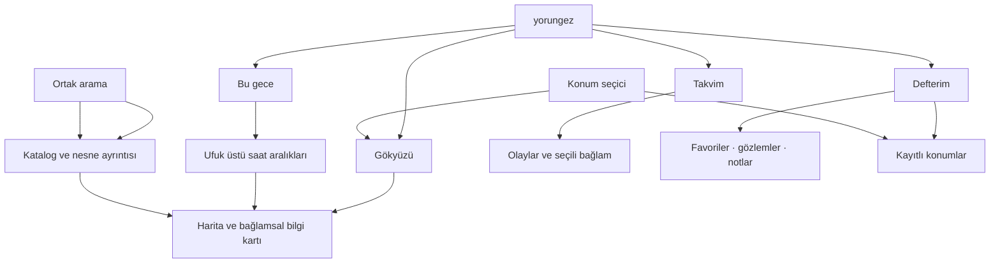
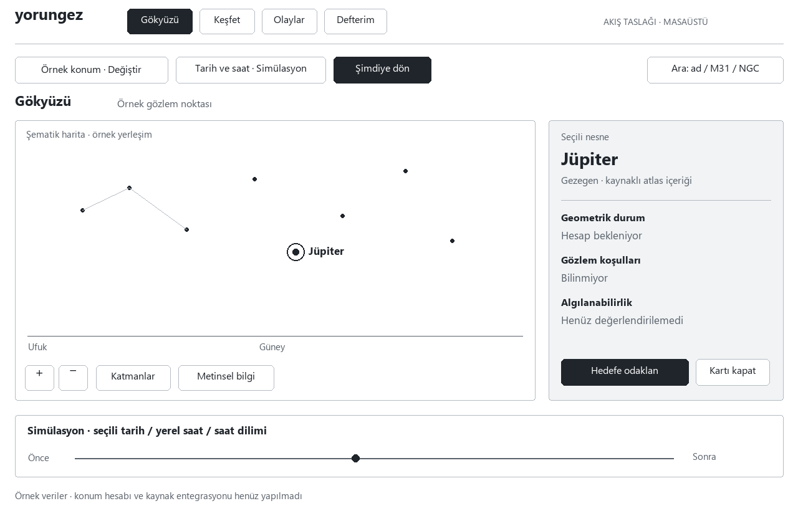
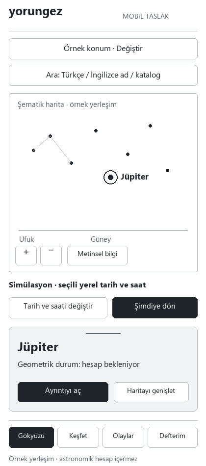
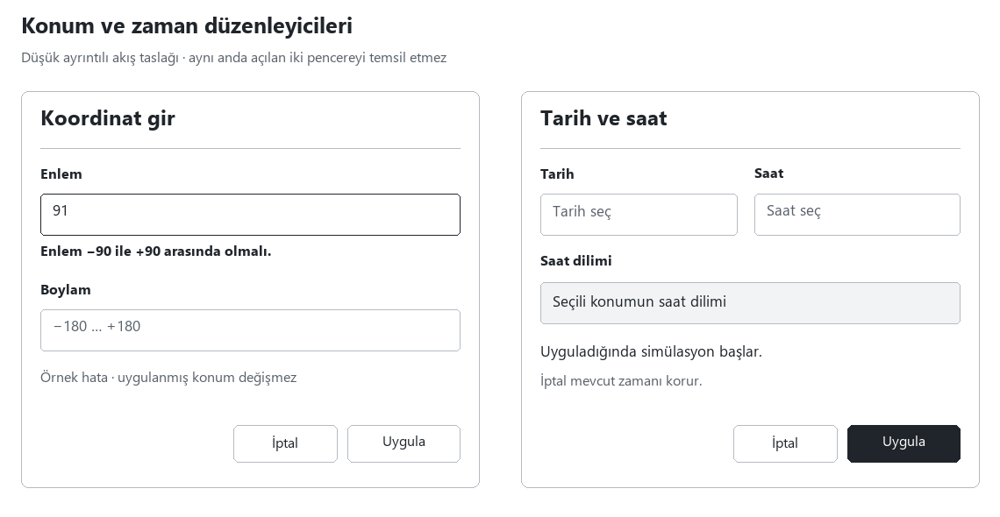

# yorungez — Bilgi mimarisi, ekranlar ve harita akışları

**Güncel TECH-07 / K-027–028 (1 Kasım 2026):** Menüde giriş/kayıt veya doğrulanmış oturumun ad-soyadı; kayıt için ad/soyad/e-posta/parola. Servis hatası ve çevrimdışı durum ayrıldı, ortak yerel başlatıcı eklendi. Genel katalog/terim/takvim için hash doğrulamalı PWA paketi ve yeniden açılış uygulandı; kişisel kayıt/oturum/koordinat cache'e girmez. 125 .NET/44 istemci testi; fiziksel cihaz/üretim backup kabulü açık. [Uygulama ve kanıt](hesap-menusu-ve-cevrimdisi-gokyuzu.md), [hesap ADR](adr/0012-hesap-menusu-ve-ad-soyad.md), [PWA ADR](adr/0013-genel-gokyuzu-pwa-ve-cevrimdisi-paket.md).

**Güncel K-026 / TECH-06 (1 Kasım 2026):** Hesap envanterinde not/favori yanında ayrı gözlem ve kayıtlı konum uygulandı. Gözlem açıklama + kişisel beyan ister; gerçek zaman/nesne/konum isteğe bağlıdır, simülasyon zamanı kendiliğinden bağlanmaz. Konum kopyası geçmişi korur; haritada kullanım an/mod/hedef/kamerayı korur. 120 .NET + 38 istemci testi ve üretim derlemesi geçti; 52 tr/en terim/cache .7. [Uygulama ve sınırlar](gozlem-kayitlari-ve-kayitli-konumlar.md), [ADR-0011](adr/0011-gozlem-kaydi-ve-kayitli-konumlar.md). Fiziksel cihaz, genel katalog PWA/offline ve üretim backup kabulü açık; kişisel tarayıcı kalıcılığı yoktur.

**Güncel K-024 / TECH-05:** Kişisel kayıt için doğrulanmış hesap zorunlu; anonim/IndexedDB kişisel kalıcılığı kaldırıldı. Not ve favoriler kullanıcıya bağlı PostgreSQL modülünde; TR/EN kayıt/giriş/doğrulama/sıfırlama ve panel geri dönüşü bağlıdır. [Uygulama ve sınırlar](hesap-ve-sunucu-defteri.md), [ADR-0010](adr/0010-hesap-zorunlu-defter-ve-sunucu-kayitlari.md). Aşağıdaki eski paket kayıtları kendi aşamasının tarihsel kanıtıdır.

**Önceki K-022 / TECH-04D yüzeyi:** Menü Gökyüzü/Bu gece/Takvim/Defterim; özel ortak liste/tarih/saat ve sensörsüz rehber [güncel kayıtta](ortak-bilesenler-ve-sensorsuz-gozlem.md). İlk yerel kişisel kayıt ile hesap/offline sonraki ekranları [UX-02](kisisel-kayit-hesap-cevrimdisi-akislari.md) içindedir. Eski native liste/Today/wireframe önerileri tarihsel kalır.

**K-021 / TECH-04C güncel menü:** Gökyüzü, Bugün/Bu gece, Takvim, Defterim. Arama odaklayan Keşfet kaldırıldı; katalog/ortak arama işlevi korunur. Çizelge çubuğu/olay → UTC/hedef/simülasyon → kart/pusula; saydam ufuk altı ve geniş açı [uygulama kaydındadır](gozlem-cizelgesi-ve-takvim.md). Aşağıdaki 30 Ekim menü/wireframe önerileri tarihsel referanstır.

**TECH-04B güncel yüzey:** Kullanıcı paleti ve sol menüde native dil listesi, kaynaklı fotoğraf çevre ve ayrı pusula penceresi [yeni kayıtta](dogal-gorunum-ve-pusula.md). Aşağıdaki eski wireframe’ler tarihsel öneri olarak kalır.

**Güncel yerleşim kararı — 31 Ekim/K-019:** Kullanıcı talimatıyla kalıcı topbar/sidebar ve eski sabit panellerin yerini tam ekran harita, başlangıçta kapalı sol menü, gri/bordo saydam yüzen kart/araçlar aldı. Aşağıdaki 30 Ekim wireframe gövdeleri tarihsel öneridir. IANA/yerel/UTC politikası A-014/ADR-0005 ile artık uygulanmıştır. [Güncel ekranlar/kanıt](tam-ekran-harita-gelistirmesi.md), [masaüstü](ux/planetarium/desktop-sun-tr.png), [mobil harita](ux/planetarium/mobile-map-en.png). P0 UX-02 ve gerçek kullanıcı/cihaz/ekran okuyucu kabulü açıktır.

**Tarih:** 30 Ekim 2026  
**Durum:** İlk UX önerisi ve düşük ayrıntılı wireframe'ler. Çalışan ürün veya kullanıcı testi sonucu değildir. Renk, tipografi ve marka tasarımı kesinleştirilmedi.  
**İş:** UX-01; UX-02 ekranları ayrıca hazırlanacak. Kaynaklar: [gereksinimler](urun-gereksinimleri.md), [görevler](kullanici-gorevleri.md), [bağlam ve sınır durumları](baglam-ve-sinir-durumlari.md).

**31 Ekim uygulama notu:** Bu belge ilk wireframe önerisini korur. Sonraki çalışan ilk harita/yan-alt panel/arama/kart/terimler ve geliştirici denemesi [TECH-02B/03 kaydındadır](harita-ve-katalog-denemesi.md); [masaüstü](ux/prototype/desktop-tr.png) ve [dar ekran](ux/prototype/mobile-en.png) üretim derlemesi görüntüleridir. Kişisel kayıt/hesap/offline UX-02, gerçek kullanıcı/cihaz/ekran okuyucu kabulü açık kalır.

## Bilgi mimarisi

Güncel menü K-021 ile güncellendi; atlas kapsamı ortak arama/kartta korunur. Arama bütün bölümlerden erişilen ortak bir işlevdir; konum seçici Gökyüzü'nden ve kayıtlı konumlar Defterim'den erişilir. Geçişler aynı keşif bağlamını taşır. URL/route yapısı henüz mimari kararı değildir.

## Ekran ve panel envanteri

| ID | Yüzey | Ana içerik / durumlar | Kapsam / iz |
|---|---|---|---|
| **EK-01** | Gökyüzü | Baskın harita, konum ve zaman, ortak arama, yön/zoom; hedef yokken bağlamsal “Bu gece” alanı | MVP-0 çekirdek; FR-01–04, UJ-01–03 |
| **EK-02** | Nesne bilgi kartı | Tek nesne kimliği; kaynaklı atlas bilgisi; geometrik durum, koşullar ve algılanabilirlik ayrı | MVP-0 temel kart; FR-03, FR-05, AC-04, AC-06 |
| **EK-03** | Ortak arama | Türkçe/İngilizce ad ve katalog kimliği; eşleşme, boş sonuç, katalog erişilemiyor | MVP-0 temel arama, P1 geniş filtreler; FR-03, AC-04 |
| **EK-04** | Konum seçici | Mevcut konum kaynağı, GPS eylemi, manuel koordinat; varsa kayıtlı konumlara erişim | MVP-0 konum; kayıtlı yerler P0; FR-01, FR-06 |
| **EK-05** | Koordinat düzenleyici | Enlem/boylam, biçim açıklaması, alan hataları, uygula/iptal; önceki geçerli bağlam korunur | MVP-0; SN-K02–07, AC-02–03 |
| **EK-06** | Zaman düzenleyici | Yerel tarih/saat, saat dilimi bağlamı, uygula/iptal; belirsiz/olmayan saat açıklaması | MVP-0 zaman; SN-Z01–09, AC-03, AC-05; A-014 açık |
| **EK-07** | Harita görünüm kontrolleri | Yön, zoom, hedefe odaklanma; katman seçenekleri kaynak kapsamına göre | MVP-0 temel etkileşim / P0 katmanlar; FR-02, AC-11 |
| **EK-08** | Haritaya eşdeğer metinsel bilgi | Seçili bağlam ve nesne listesi; nesneyi karttan seçebilme, yön/yükseklik ve bilinmiyor durumları | Erişilebilirlik yaklaşımı; FR-02–03, gereksinimler §8 |
| **EK-09** | Olaylar | Temel Ay/Güneş/olay bilgileri; kapsamlı takvim ve uygun pencereler sonraki sürüm | P0 temel / P1 derinlik; FR-04 |
| **EK-10** | Defterim ve kayıt düzenleyicileri | Hesap zorunlu favori/not; gözlem/kayıtlı yer modeli sonraki dilim | P0; FR-06–07, UJ-04–05; UX-02 ayrıntısı bekliyor |
| **EK-11** | Hesap ve veri aktarımı | Kayıt/giriş, doğrulama, kurtarma; sunucu kaydı ve revizyon çakışması | P0; FR-07, AC-07–09; UX-02 ayrıntısı bekliyor |
| **EK-12** | Veri/bağlantı durumu | Hesap bekleniyor/başarısız, katalog kaynağı, eski dış veri, çevrimdışı/senkronizasyon durumu | MVP-0 hesap hataları / P0 çevrimdışı / P1 hava; FR-08–09, AC-10, AC-12 |

Bu envanterde P0/P1 olarak işaretlenen bir yüzeyin yer alması MVP-0'a eklendiği anlamına gelmez. Görseller yalnızca harita ve düzenleyici yerleşimlerini gösterir; Defterim veya hesap işlevi uygulamaz.

## Masaüstü yerleşimi

[Düzenlenebilir SVG](ux/wireframes/masaustu.svg).

Gösterilen örnek durum seçili nesne + simülasyondur; ilk açılışta bu örnek nesne veya simülasyonun otomatik seçileceği anlamına gelmez.

- Ortak navigasyon üstte; konum ve zaman kontrolleri haritayla birlikte görünür kalır. Ana alan haritadır; sağ panel seçili nesneyi veya hedef yoksa “Bu gece” içeriğini taşır.
- Ortak arama EK-03 yüzeyini açar; sonuç seçimi EK-02 kartını aynı bağlamla günceller. Metinsel bilgi yolu haritanın kullanımını zorunlu kılmaz.
- Sağ kartın kapatılması hedefe ilişkin arayüz ayrıntısını kapatır; konum ve zaman sıfırlanmaz. Hedefi kaldırma ile paneli daraltma ayrı eylemlerdir.
- Harita zamanı ve mod etiketi beraber sunulur. Simülasyonda “Şimdiye dön” eylemi görünürdür.

## Mobil yerleşimi ve alt panel

[Düzenlenebilir SVG](ux/wireframes/mobil.svg).

| Alt panel durumu | Görünen içerik | Eylem / bağlam |
|---|---|---|
| Kapalı / küçültülmüş | Hedef varsa kısa kimlik ve ayrıntıya erişim; harita öncelikli | Tek eylemle özet açılır; konum, zaman ve hedef korunur |
| Kısmen açık | Hedef adı, temel geometrik durum ve gerekli kısa açıklama | Ayrıntıyı aç veya haritayı genişlet; görünür düğmeler sürüklemeye alternatif olur |
| Ayrıntılı | Atlas, üç ayrı görünürlük değerlendirmesi, kaynak ve geçerli eylemler | Tek eylemle özet/harita durumuna dönüş; klavye ve ekran okuyucu için aynı bilgi |

Kesin panel yüksekliği ve kırılma noktaları cihaz denemeleriyle belirlenecek. Dokunma hedefleri, uzun Türkçe/İngilizce metinler, büyük yazı ve sanal klavye ayrıca değerlendirilecek; çizimler bu kontrollerden geçmiş bir uygulama değildir.

## Konum ve zaman düzenleyicileri

[Düzenlenebilir SVG](ux/wireframes/duzenleyiciler.svg).

Görselleri yerelde yeniden üretmek için `python docs/ux/wireframes/render_wireframes.py` kullanılabilir. Bu isteğe bağlı dokümantasyon aracı mevcut ortamda Pillow ve Windows Segoe UI fontlarını kullanır; ürünün frontend veya backend bağımlılık seçimi değildir. PNG'ler ile düzenlenebilir SVG'ler aynı çizim tanımlarından üretilir.

Yerleşimler bir UX önerisidir. Koordinat örnekleri bir varsayılan proje konumu oluşturmaz; zaman alanları temsili yer tutuculardır. Saat dilimi sağlayıcısı, tarih aralığı ve yerel saat politikası A-003/A-014'te açık kalır.

## Ana etkileşim akışları

### AK-01 — İlk ziyaret ve konum

1. EK-01 etiketli örnek konumla açılır; üyelik, ekipman veya otomatik konum izni araya girmez.
2. Kullanıcı EK-04'ü açar; konumu açık eylemle ister veya EK-05'ten manuel girer.
3. GPS reddi/alınamaması manuel yolu açık tutar. Geçersiz koordinat alan hatası üretir; önceki bağlam korunur.
4. Geçerli seçim uygulandığında harita ve kart aynı konuma geçer. Mevcut zaman/hedef gereksiz sıfırlanmaz.

**İz:** KG-01–02; UJ-01; AC-01–03; SN-K01–07.

### AK-02 — Nesne seçimi ve görünürlük

1. Harita işaretinden veya EK-03 arama sonucundan aynı tekil nesne seçilir.
2. EK-02 kaynaklı atlas içeriğini gösterir; bağlama bağlı sonuç hazır değilse hesap bekleniyor/hesaplanamadı durumunu ayırır.
3. Ufuk altındaki hedefin atlası açılır. Hedef görünür hale gelsin diye konum veya zaman kendiliğinden değiştirilmez.
4. “Haritada göster / hedefe odaklan” açık kullanıcı eylemidir. Hesaplanabiliyorsa sonraki uygun zaman ayrı bir öneri olabilir; uygulama seçimi ayrıca gerektirir.
5. Geometrik durum, koşullar ve algılanabilirlik ayrı başlıklarla gösterilir; hava yoksa bilinmiyor olarak kalır.

**İz:** KG-03, KG-05; UJ-02; AC-03–04, AC-06, AC-10; SN-G01–08.

### AK-03 — Zamanı değiştirme ve şimdiye dönüş

1. EK-06 mevcut seçili anın yerel gösterimi ve saat dilimi bağlamıyla açılır. Düzenleme esnasında mevcut bağlam değişmez.
2. Geçersiz, belirsiz veya mevcut olmayan yerel saat açıklanır; sessizce başka bir ana kaydırılmaz. Nihai saat politikası A-014'tür.
3. Geçerli seçim uygulanınca simülasyon etiketi ve yeni seçili zaman birlikte görünür; hedef/konum korunur.
4. Geciken eski sonuç yeni seçimi ezmez. “Şimdiye dön” tek eylemle canlı modu seçer.

**İz:** KG-04; UJ-03; AC-03, AC-05; SN-Z01–09, SN-G06, SN-G08.

### AK-04 — Mobilde ayrıntı ve sensör yokluğu

1. Kullanıcı haritayı manuel yönlendirir; sensör desteği ana keşfe erişim şartı olmaz.
2. Hedef seçilince özet alt panel açılır. Kullanıcı görünür eylemlerle ayrıntıya veya geniş haritaya dönebilir.
3. Panelin durum değişikliği konumu/zamanı/hedefi değiştirmez. Sensör izni ve GPS izni ayrı durumlardır.
4. Aynı içerik EK-08 metinsel yolunda klavyeyle ve ekran okuyucuyla ulaşılabilir olmalıdır.

**İz:** KG-06; UJ-06; AC-04, AC-11; SN-K08; gereksinimler §8.

## Durum mesajları ve geri dönüş

| Durum | Kısa metin önerisi | Kullanıcının devam yolu |
|---|---|---|
| Örnek konum | “Örnek konum” | Konumu değiştir |
| GPS reddi / alınamaması | “Konum alınamadı. Koordinat girerek devam edebilirsin.” | Koordinat gir; mevcut haritaya dön |
| Geçersiz enlem | “Enlem −90 ile +90 arasında olmalı.” | Hatalı alanı düzelt; iptal |
| Sonuç bekleniyor | “Seçili konum ve zaman için hesaplanıyor.” | Katalog içeriğini incele; bağlam etiketini gör |
| Hesap başarısız | “Bu konum ve zaman için konum bilgisi hesaplanamadı.” | Ayrıntılı neden varsa aç; yeniden dene; atlası kullan |
| Ufuk altı | “Bu konum ve zamanda ufkun altında.” | Atlası incele; hesaplanmış uygun zaman varsa gör |
| Koşul bilinmiyor | “Gözlem koşulları bilinmiyor.” | Geometrik bilgiye bak; kesin gözlem sonucu bekleme |
| Simülasyon | “Simülasyon” + seçili tarih/saat | Şimdiye dön |
| Boş arama | “Eşleşme bulunamadı.” | Başka ad veya katalog kimliği dene; aramayı kapat |
| Önbellekli kullanım | “Çevrimdışı · önceden yüklenen içerik” | Desteklenen yerel işlevler; veri güncelliğini incele |

Metinler taslaktır; nihai Türkçe/İngilizce metinler, hata nedenleri ve ekran okuyucu duyuruları gerçek prototipte kontrol edilecek.

## Erişilebilirlik ve inceleme listesi

- Konum, zaman, arama, zoom, yön ve panel açma/kapatma eylemleri klavyeyle erişilebilir ve anlaşılır etiketlidir.
- Düzenleyici açma/kapatma, odak geri dönüşü ve hata alanına erişim tasarlanır; hatalar yalnızca renk veya geçici bildirimle anlatılmaz.
- Canlı hesap güncellemeleri ekran okuyucuyu sürekli bölmez; anlamlı değişiklik ve hata duyurusu ayrılır.
- Nesne bilgisi ve temel keşif görevi yalnızca görsel harita işaretlerine bağlı değildir; EK-08 metinsel yoluyla aynı kimlik/kart kullanılır.
- Zaman modu, örnek konum, bilinmeyen veri ve senkronizasyon durumu yalnızca renk koduyla gösterilmez.
- Dar ekran, büyütülmüş yazı, uzun etiket, panel içeriği, dokunma ve sensör yokluğu gerçek cihaz/çalışan prototipte ayrıca sınanır.

## Kanıt ve sonraki adım

Bu pakette ekran envanteri, akışlar, durum mesajları ve üç statik wireframe üretildi. Astronomik hesap, işleyen UI, gerçek kullanıcı görevi, sensör, kalıcılık, performans veya WCAG uygunluğu henüz doğrulanmadı.

İlk sınırlı hesap adaptörü ve referans denemesi [ADR-0003](adr/0003-ilk-astronomi-adaptoru-ve-dogruluk-sinirlari.md) ile eklendi; UI akışları henüz uygulanmadı. Sonraki teknik araştırma çizim motoru, geniş tarih ve saat dilimi sözleşmesi, katalog kimliği ve çevrimdışı veri sınırlarını [karar kaydındaki](kararlar.md) A-002–009 ve A-014 sorularıyla değerlendirecek. P0 kişisel kayıt/hesap/çevrimdışı ekranları UX-02'de ayrıca ayrıntılandırılacak.
